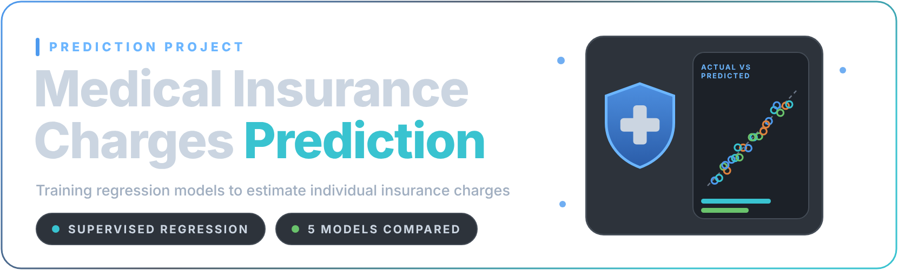
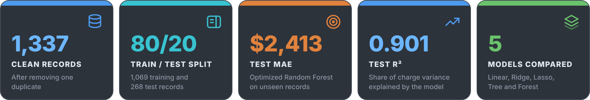
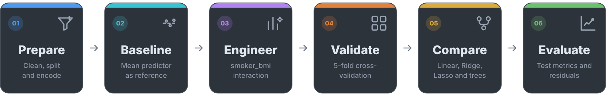
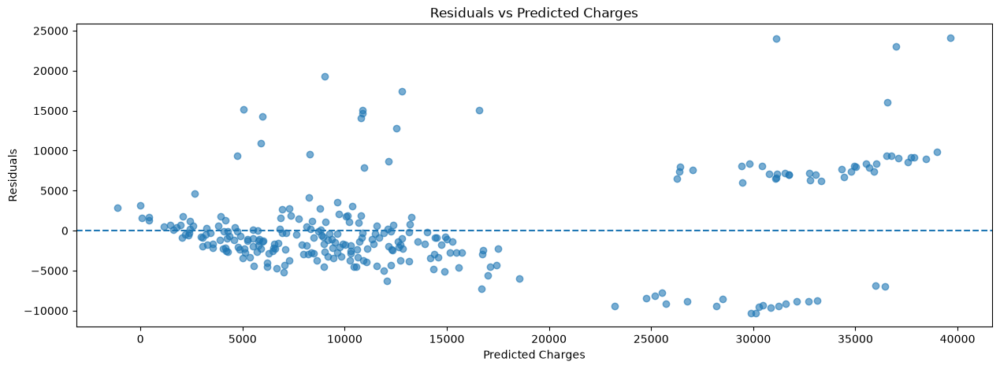
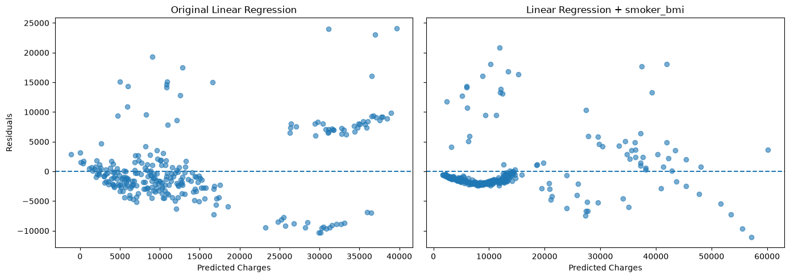
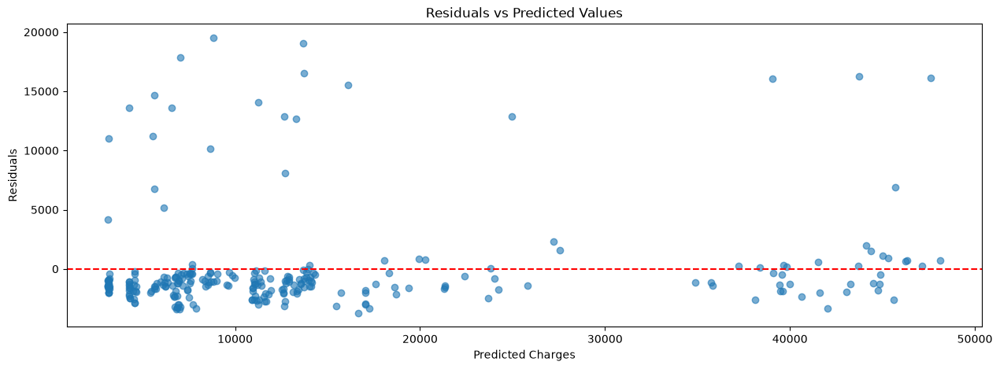
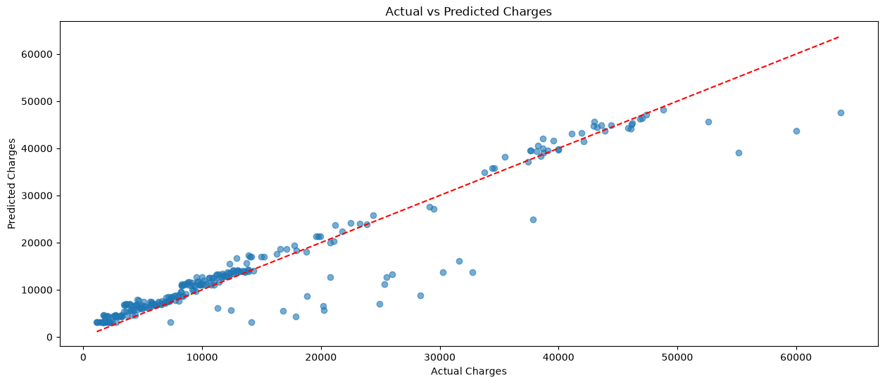
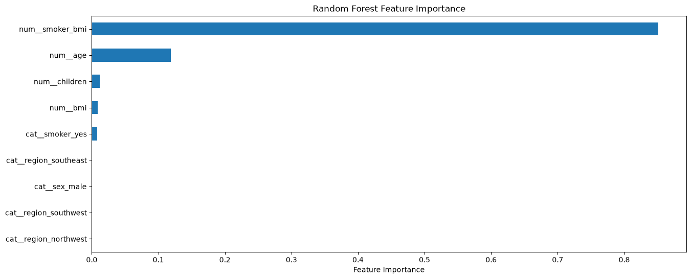

<div align="center">
  
  <br>
  <strong>Supervised Machine Learning | Regression</strong>
  <br>
  <span>Building and comparing models to estimate individual medical insurance charges</span>
  <br><br>
  
</div>


<br><br>


<br><br>

The previous project, **Data Analysis**, explored how customer characteristics are associated with annual medical insurance charges.  
This project takes the next step and uses those same characteristics to **predict** the charge of a customer the model has never seen.  

The task is **supervised learning** because every training record contains both the customer features and the known charge.  
It is a **regression problem** because the target, annual charges in US dollars, is a continuous number.  

The main questions behind the project are:

> **Can customer characteristics predict medical insurance charges, and which regression model does it best?**

* How accurately can Machine Learning models predict these charges?  
* Which regression models perform best on unseen data?  
* Which features are the most useful for making predictions?  

The project focuses on prediction, not on proving cause and effect.  
The outputs are estimates based on historical data, not official insurance quotations.  

<br><br>

<br><br>


The notebook uses the same `insurance.csv` file as the analysis.
The original data contains **1,338 records**.  
One exact duplicate row was removed and no missing values were found, leaving **1,337 unique records** for modeling.  

<div align="center">
  
</div>

### Features and target

| Field | Description | Role | Type |
|:--|:--|:--|:--|
| `age` | Customer age in years | Feature | Numerical |
| `sex` | Female or male | Feature | Categorical |
| `bmi` | Body Mass Index | Feature | Numerical |
| `children` | Number of children covered | Feature | Numerical |
| `smoker` | Smoking status, yes or no | Feature | Categorical |
| `region` | Customer region in the United States | Feature | Categorical |
| `charges` | Annual medical insurance charges in US dollars | **Target** | Numerical |

### Preparation steps

| Step | What was done | Result |
|:--|:--|:--|
| Train and test split | 80% training and 20% testing, with `random_state=42` | **1,069** training and **268** test records |
| Scaling | `StandardScaler` on `age`, `bmi` and `children` | Mean 0 and standard deviation 1 on the training set |
| Encoding | `OneHotEncoder` with `drop="first"` on `sex`, `smoker` and `region` | 3 numerical and 5 encoded columns, **8 model inputs** |
| Pipeline | Preprocessing and model combined in one `Pipeline` | The transformations are learned from the training data only, which avoids data leakage |

<br><br>

<br><br>


The notebook follows a step by step modeling process, where each new model has to beat the previous one.
<br><br>

<div align="center">
  
</div>

<br><br>


| Stage | Prepare | Baseline | Engineer | Validate | Compare | Evaluate |
|:-:|:-:|:-:|:-:|:-:|:-:|:-:|
| Work completed | Removed the duplicate, split the data, scaled numbers and encoded categories | Trained a model that always predicts the average charge | Created the `smoker_bmi` interaction feature | Used 5 fold cross validation inside pipelines | Tuned Ridge, Lasso, Decision Tree and Random Forest with `GridSearchCV` | Measured the final model on the test set and studied its errors |

Three metrics are used in every comparison.

| Metric | What it measures |
|:--|:--|
| **MAE** | The average size of the prediction error, in dollars. Lower is better |
| **RMSE** | Similar to MAE but it punishes large errors more. Lower is better |
| **R²** | The share of the variation in charges explained by the model. Higher is better, and 1 is perfect |

<br><br>

<br><br>


### 4.1 | Baseline Model

A baseline gives every model a minimum score to beat.  
The baseline here is a `DummyRegressor` that predicts the **average training charge** (**$13,030.20**) for every customer.

| Model | MAE | RMSE | R² |
|:--|--:|--:|--:|
| Baseline (mean) | $9,861.80 | $13,612.43 | -0.0084 |

The negative R² means the baseline is no better than simply guessing the mean of the test data.

### 4.2 | Linear Regression

A first Linear Regression model uses the 8 processed features.

| Model | MAE | RMSE | R² |
|:--|--:|--:|--:|
| Baseline (mean) | $9,861.80 | $13,612.43 | -0.0084 |
| **Linear Regression** | **$4,177.05** | **$5,956.34** | **0.8069** |

Compared with the baseline, MAE decreased by about **57.6%** and RMSE by about **56.2%**.  
The model explains about **80.7%** of the variation in charges in the test data.  

The largest coefficients show what the model relies on.    
`smoker_yes` has the largest weight (about **$23,078**), followed by `age` (about **$3,473**) and `bmi` (about **$1,928**).  

<div align="center">
  
  <em>Figure 1 | Residuals of the first Linear Regression model against its predicted charges</em>
</div>

<br><br>

The residuals are not scattered evenly around zero.  
The errors grow for higher predicted charges, and the largest error is about **$24,111** (the model predicted about $39,659 for a real charge of $63,770).  
This suggests that a simple linear relationship misses part of the pattern.  

### 4.3 | Feature Engineering: the Smoker and BMI Interaction

The data analysis showed that the effect of BMI looks different for customers who smoke and customers who do not.  
A plain linear model cannot represent this, so a new feature was created.

```python
smoker_bmi = bmi * (smoker == "yes")
```

This feature equals the BMI for customers who smoke and zero for everyone else, so the model can learn a separate BMI effect for each smoking group.

| Model | MAE | RMSE | R² |
|:--|--:|--:|--:|
| Original Linear Regression | $4,177.05 | $5,956.34 | 0.8069 |
| **Linear Regression + `smoker_bmi`** | **$2,828.97** | **$4,572.81** | **0.8862** |

MAE decreased by about **32.3%** and RMSE by about **23.2%**, while R² rose from 0.8069 to **0.8862**.

| Dataset | MAE | RMSE | R² |
|:--|--:|--:|--:|
| Training | $2,967.98 | $4,898.70 | 0.8247 |
| Testing | $2,828.97 | $4,572.81 | 0.8862 |

Training and test results are close, so there is no clear sign of overfitting on this split.

<div align="center">
  
  <em>Figure 2 | Residuals before (left) and after (right) adding the smoker and BMI interaction</em>
</div>

<br><br>

The mean residual moved from **$425.26** to **-$44.37**, and the largest positive error dropped from about $24,111 to about $20,813.  
Large errors still remain for expensive cases.

### 4.4 | Cross Validation

One train and test split can be lucky or unlucky.  
To get a more reliable estimate, both linear models were evaluated with **5 fold cross validation** on the training data, with the feature engineering inside the pipeline.  

| Model | Mean MAE | Mean RMSE | Mean R² |
|:--|--:|--:|--:|
| Original Linear Regression | $4,221.96 | $6,123.65 | 0.7228 |
| **Linear Regression + `smoker_bmi`** | **$2,992.73** | **$4,943.01** | **0.8188** |

The engineered model was better in **all five folds** for MAE, RMSE and R².  
Its standard deviations were also lower (MAE standard deviation of $125.44 against $208.55), so its performance was more stable.  
The `smoker_bmi` feature was therefore kept in all the following experiments.  

### 4.5 | Ridge and Lasso Regularization

Ridge (L2) and Lasso (L1) add a penalty on large coefficients.  
Both were tuned over seven values of `alpha` (0.001 to 1000) using `GridSearchCV`.  

| Model | Best alpha | Mean MAE | Mean RMSE | Mean R² |
|:--|:-:|--:|--:|--:|
| Linear Regression + `smoker_bmi` | not used | $2,992.73 | $4,943.01 | 0.8188 |
| Ridge | 0.1 | $2,992.12 | $4,942.79 | 0.8188 |
| Lasso | 1 | $2,992.72 | $4,942.92 | 0.8188 |

The three models are almost identical.  
Strong regularization made the results worse (Ridge with `alpha = 1000` reached a mean MAE of $5,513.45).  
Lasso also kept **all nine features**, so it did not remove anything.  
Standardizing the one hot encoded columns before regularization gave the same result, so regularization does not help on this dataset.  

### 4.6 | Decision Tree and Random Forest

Tree based models can capture non linear patterns and interactions without a hand made feature.  
Both were tuned with `GridSearchCV` and evaluated with 5 fold cross validation.  

| Model | Tuned parameters | Mean MAE | Mean RMSE | Mean R² |
|:--|:--|--:|--:|--:|
| Decision Tree (no limit) | none | $3,301.55 | $6,747.10 | 0.6631 |
| Decision Tree (tuned) | `max_depth = 5` | $2,731.39 | $4,820.31 | 0.8259 |
| Random Forest (default, 200 trees) | none | $2,769.82 | $4,921.02 | 0.8196 |
| **Random Forest (tuned)** | `max_depth = 5`, `min_samples_leaf = 4`, `max_features = 1.0` | **$2,556.94** | **$4,579.90** | **0.8437** |

An unlimited Decision Tree overfits, and limiting its depth improved it clearly.  
The tuned Random Forest combines 200 trees and gave the best result of all the models.  

<br><br>

<br><br>


### 5.1 | Model Comparison

All five approaches were compared with the same 5 fold cross validation.

| Rank | Model | Mean MAE | Mean RMSE | Mean R² |
|:-:|:--|--:|--:|--:|
| 1 | **Random Forest** | **$2,556.94** | **$4,579.90** | **0.8437** |
| 2 | Decision Tree | $2,731.39 | $4,820.31 | 0.8259 |
| 3 | Ridge | $2,992.12 | $4,942.79 | 0.8188 |
| 4 | Lasso | $2,992.72 | $4,942.92 | 0.8188 |
| 5 | Linear Regression | $2,992.73 | $4,943.01 | 0.8188 |

### 5.2 | Final Test Results

The tuned Random Forest was selected and evaluated on the 268 test records.

| Metric | Value | Reading |
|:--|--:|:--|
| MAE | **$2,413.40** | On average, a prediction is off by about $2,400 |
| RMSE | **$4,260.41** | Large errors are still present for expensive customers |
| R² | **0.9012** | About 90% of the variation in charges is explained |

### 5.3 | Residual Analysis

<div align="center">
  
  <em>Figure 3 | Residuals of the final Random Forest against its predicted charges</em>
</div>
<br><br>

Most predictions are close to the true charge, with the errors clustered around zero.  
The larger errors appear mainly for customers with high predicted charges, which are the most expensive and the hardest cases to predict.  

### 5.4 | Actual vs Predicted

<div align="center">
  
  <em>Figure 4 | Actual and predicted charges on the test set, with the perfect prediction line</em>
</div>
<br><br>

The points follow the dashed perfect prediction line closely, which matches the R² of 0.9012.  
The points that sit far from the line are the same expensive cases that appear in the residual plot.  

### 5.5 | Feature Importance

<div align="center">
  
  <em>Figure 5 | Feature importance in the final Random Forest</em>
</div>
<br><br>

The engineered `smoker_bmi` feature is by far the most important one, with an importance of about **0.85**.  
Age comes second with about **0.12**, and the remaining features each add very little.  
This agrees with the data analysis, where smoking status, BMI and age were the clearest patterns.  
Impurity based importance describes how the model uses its inputs and does not prove cause and effect.  

### 5.6 | Saved Model

The final pipeline was saved with `joblib` as `Model/insurance_Cost_model.joblib`.  
It contains the feature engineering, the preprocessing and the trained Random Forest, so it accepts raw customer data directly.  

```python
import joblib
import pandas as pd

model = joblib.load("Model/insurance_Cost_model.joblib")

customer = pd.DataFrame([{
    "age": 40, "sex": "male", "bmi": 28.5,
    "children": 2, "smoker": "no", "region": "northwest"
}])

print(model.predict(customer))
```

<br><br>

<br><br>


<table>
  <tr>
    <td width="33%" valign="top">
      <strong><span style="color:#168A87">BASELINE</span></strong>
      <br><br>
      Predicting the average charge gives an MAE of <strong>$9,862</strong> and a negative R², so every model has a clear score to beat.
    </td>
    <td width="33%" valign="top">
      <strong><span style="color:#2878C7">FEATURE ENGINEERING</span></strong>
      <br><br>
      The <strong>smoker and BMI interaction</strong> raised the linear model R² from 0.8069 to 0.8862 and won in all five folds.
    </td>
    <td width="33%" valign="top">
      <strong><span style="color:#B8792D">REGULARIZATION</span></strong>
      <br><br>
      Ridge and Lasso gave almost the same results as plain Linear Regression, so they added nothing here.
    </td>
  </tr>
  <tr>
    <td valign="top">
      <strong><span style="color:#2878C7">BEST MODEL</span></strong>
      <br><br>
      The tuned <strong>Random Forest</strong> had the best cross validation score with a mean MAE of $2,557 and R² of 0.8437.
    </td>
    <td valign="top">
      <strong><span style="color:#168A87">TEST RESULT</span></strong>
      <br><br>
      On the test set the final model reached an MAE of <strong>$2,413</strong>, an RMSE of $4,260 and an R² of <strong>0.9012</strong>.
    </td>
    <td valign="top">
      <strong><span style="color:#6C69C8">TOP PREDICTORS</span></strong>
      <br><br>
      <code>smoker_bmi</code> (about 0.85) and <code>age</code> (about 0.12) carry almost all of the model importance.
    </td>
  </tr>
</table>

<br><br>


**The final test set is not fully independent.** :
The test set was also used to compare the linear models during feature engineering, so the final test score is slightly optimistic.  
Cross validation on the training data gives the more cautious estimate (R² of 0.8437).

**Large errors remain for expensive customers.** :
The residual plots show the biggest mistakes at high predicted charges, where the model is least reliable.

**The data has limited information.** :
Only six customer fields are available. Health history, medical conditions and many other drivers of insurance cost are missing.

**Feature importance is not causation.** :
It shows how the Random Forest uses its inputs, not why a charge is high.

**The dataset is small.** :
With 1,337 records, results can change with a different split or more data.

**The model is not a quotation tool.** :
The outputs are estimates learned from historical data and must not be used to set an individual customer's premium.

<br><br>


````
Predictions/
├── Insurance_Predictions.ipynb  # Prediction notebook
├── Model/                       # Saved model
│   └── insurance_Cost_model.joblib
├── Plots/                       # Model evaluation charts
│   ├── 01_linear_residuals_vs_predicted.png
│   ├── 02_linear_residual_comparison.png
│   └── ...                      # Other plot images
├── assets/                      # Project images
│   ├── Plots/                   # Images used in the project
│   ├── hero_banner.png
│   ├── key_metrics.png
│   └── ...                      # Other project images
└── README.md                    # Prediction overview
````
