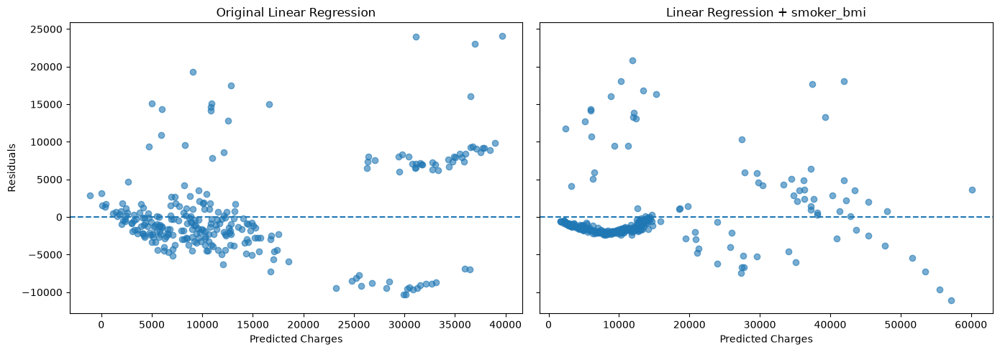
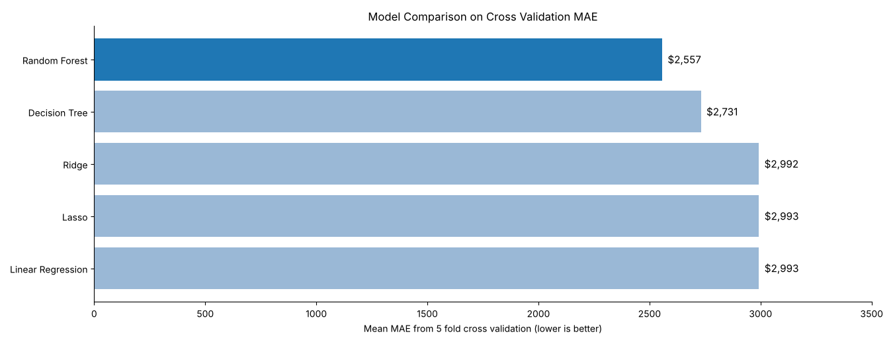
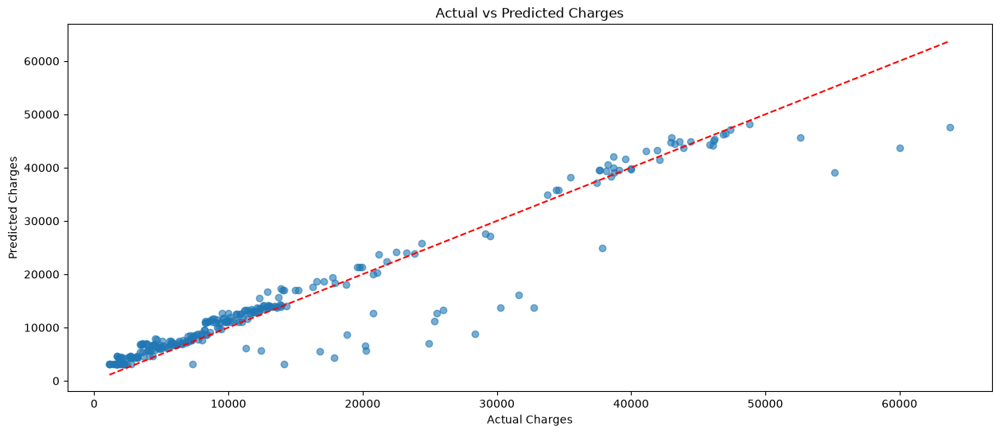
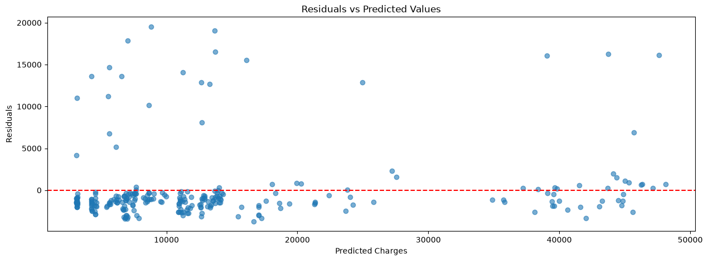
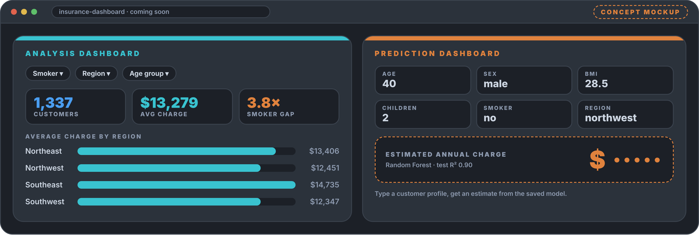

<div align="center">
  
  <br>
  <strong>My learning journey with one real dataset</strong>
  <br>
  <span>From the first look at the data, to a prediction model, to an interactive dashboard</span>
  <br><br>
  
</div>


<br><br>


<br><br>

I am a student learning data analysis and machine learning, and I wanted one project that takes me through the whole path from raw data to a finished product
This repository is that project

I chose a medical insurance dataset because it is small enough to understand completely and rich enough to teach me real lessons
Every customer has a few simple details, and every customer has one yearly insurance charge

The project has three parts

1. **Data Analysis** where I explore the data and try to understand it
2. **Predictions** where I use what I found to build models that estimate a charge
3. **Dashboard** where I turn both parts into an app that anyone can explore without opening a notebook

The main question behind everything is simple

> **Which customer traits are linked to higher medical insurance charges, and can I use them to predict the charge of a new customer?**

| Part | Main question | Folder | Status |
|:--|:--|:--|:--|
| Data Analysis | Which traits show the clearest link with charges? | `Data Analysis/` | Finished |
| Predictions | How well can a model estimate a charge for an unseen customer? | `Predictions/` | Finished |
| Dashboard | How can I let other people explore the results themselves? | `DashBoard/` | Planned, see section 06 |

### The dataset

The original file has **1,338 customers** and **7 columns**
I found one exact duplicate row and removed it, so every part of the project uses **1,337 unique customers**
There are no missing values

| Column | What it means | Type |
|:--|:--|:--|
| `age` | Customer age in years | Number |
| `sex` | Female or male | Category |
| `bmi` | Body Mass Index | Number |
| `children` | Number of children covered | Number |
| `smoker` | Smoking status, yes or no | Category |
| `region` | Region in the United States | Category |
| `charges` | Yearly insurance charge in US dollars | **Target** |

This is an observational dataset, so I read every result as a pattern in the data and not as proof of cause and effect

<br><br>

<br><br>


I do not try to build the final model on day one
I learn in small steps, and every step has to teach me something before I move to the next one

These are the habits I tried to follow, and where you can see each one in the project

| Habit | What I do | Example from this project |
|:--|:--|:--|
| Start with a question | I write the question first, so I know what I am looking for | The main question at the top of this page |
| Look before I model | I clean, inspect and plot the data before any model | I found one duplicate row and removed it |
| Beat something simple | I build a baseline first, so every model has a score to beat | A model that always guesses the average charge has an MAE of **$9,861.80** |
| Change one thing at a time | I make one change, then measure it | One new feature raised the linear model R² from **0.8069** to **0.8862** |
| Do not trust one split | I use cross validation, because one split can be lucky | All five models were compared with 5 fold cross validation |
| Write down the limits | I list what my results cannot say | Each part has its own limitations section |

<br><br>

<br><br>


The first part is about understanding the data before predicting anything
I cleaned the data, compared groups, drew many charts, and ran simple statistical tests

<div align="center">
  
</div>

<br><br>

<div align="center">
  
</div>

### Step 1 | Look at how charges are spread

The average charge is **$13,279.12** and the median is **$9,386.16**
The mean sits well above the median, which tells me that a small group of customers has very high charges

<div align="center">
  
  <em>Figure 1 | Most customers have lower charges, and a few have very high ones</em>
</div>

<br>

**What I learned** : when data is right skewed, the median describes the middle customer better than the mean

### Step 2 | Check the numbers that move together

I used a correlation matrix to see which numerical columns are linked to charges

| Feature | Correlation with charges | Reading |
|:--|--:|:--|
| Age | **0.2983** | Weak to moderate positive link |
| BMI | 0.1984 | Weak positive link |
| Children | 0.0674 | Almost no linear link |

<div align="center">
  
  <em>Figure 2 | Correlation matrix for the numerical features</em>
</div>

<br>

**What I learned** : no single number explains charges on its own, and correlation never proves cause

### Step 3 | Compare the groups

Smoking status gave the clearest separation by far

| Group | Customers | Mean charge | Median charge |
|:--|--:|--:|--:|
| Does not smoke | 1,063 | $8,440.66 | $7,345.73 |
| Smokes | 274 | **$32,050.23** | **$34,456.35** |

The average charge for customers who smoke is about **3.8 times** the average for customers who do not

<table>
  <tr>
    <td width="50%">
      
      <p align="center"><em>Figure 3 | Charges by smoking status, boxplot</em></p>
    </td>
    <td width="50%">
      
      <p align="center"><em>Figure 4 | Charges by smoking status, violin plot</em></p>
    </td>
  </tr>
</table>

<br>

I also compared sex, region and number of children
Their medians were close to each other, and the statistical tests did not show a clear difference

<table>
  <tr>
    <td width="50%">
      
      <p align="center"><em>Figure 5 | Charges by sex</em></p>
    </td>
    <td width="50%">
      
      <p align="center"><em>Figure 6 | Charges by region</em></p>
    </td>
  </tr>
</table>

| Question | Test | p value | Reading at 0.05 |
|:--|:--|--:|:--|
| Do charges differ by smoking status? | Mann Whitney U | **5.75 × 10⁻¹³⁰** | Strong evidence of a difference |
| Do charges differ by sex? | Mann Whitney U | 0.694 | No clear difference found |
| Do charges differ by region? | Kruskal Wallis | 0.202 | No clear difference found |

**What I learned** : a result that is not significant does not prove two groups are the same, it only means this data did not show a difference

### Step 4 | Look deeper inside the smoking groups

This was the part I enjoyed most, because the patterns changed once I split the data by smoking status

<table>
  <tr>
    <td width="50%">
      
      <p align="center"><em>Figure 7 | BMI and charges by smoking status</em></p>
    </td>
    <td width="50%">
      
      <p align="center"><em>Figure 8 | Age and charges by smoking status</em></p>
    </td>
  </tr>
</table>

| Smoking group | BMI group | Median charge |
|:--|:--|--:|
| Does not smoke | Below 30 | $6,761.62 |
| Does not smoke | 30 or above | $8,083.92 |
| Smokes | Below 30 | $20,167.34 |
| Smokes | 30 or above | **$40,904.20** |

For customers who do not smoke, BMI changes the charge a little
For customers who smoke, a BMI of 30 or above doubles the median charge
That means BMI and smoking work together, and I carried this idea into the prediction part

<div align="center">
  
  <em>Figure 9 | Charges across the four smoking and BMI groups</em>
</div>

<br>

**What I learned** : the best clue for the next step came from the analysis, and that is why analysis comes before modeling

For every table, test and chart of this part, read the full notebook story in [Data Analysis/README.md](Data%20Analysis/README.md)

<br><br>

<br><br>


The second part uses the same customers, but now the goal is different
Instead of describing the past, I want to **predict** the charge of a customer the model has never seen

This is **supervised learning** because every training row has the answer
It is a **regression problem** because the answer is a number in dollars


<br><br>

### Step 1 | Prepare the data

| Step | What I did | Result |
|:--|:--|:--|
| Split | 80% for training and 20% for testing | **1,069** training and **268** test customers |
| Scale | `StandardScaler` on `age`, `bmi` and `children` | Numbers on the same scale |
| Encode | `OneHotEncoder` on `sex`, `smoker` and `region` | **8 model inputs** |
| Pipeline | Preprocessing and model in one `Pipeline` | No data leakage from the test set |

### Step 2 | Start simple, then improve

Each model had to beat the one before it

| Step | Model | What changed | MAE | R² |
|:--|:--|:--|--:|--:|
| 1 | Baseline | Always predicts the average charge | $9,861.80 | -0.0084 |
| 2 | Linear Regression | First real model | $4,177.05 | 0.8069 |
| 3 | Linear Regression with `smoker_bmi` | New feature from my analysis | $2,828.97 | **0.8862** |

The `smoker_bmi` feature is the idea I found in Step 4 of the analysis
It equals the BMI for customers who smoke and zero for everyone else

```python
smoker_bmi = bmi * (smoker == "yes")
```

<div align="center">
  
  <em>Figure 10 | Errors before (left) and after (right) adding the new feature</em>
</div>

<br>

**What I learned** : one good feature built from analysis helped more than any complicated setting

### Step 3 | Try more models and compare them fairly

I tried Ridge and Lasso, which add a penalty to large coefficients, and they gave almost the same result as plain Linear Regression
Then I tried a Decision Tree and a Random Forest, and tuned both with `GridSearchCV`

<div align="center">
  
  <em>Figure 11 | Mean MAE from 5 fold cross validation, using the values reported in the Predictions notebook</em>
</div>

<br>

| Rank | Model | Mean MAE | Mean R² |
|:-:|:--|--:|--:|
| 1 | **Random Forest** | **$2,556.94** | **0.8437** |
| 2 | Decision Tree | $2,731.39 | 0.8259 |
| 3 | Ridge | $2,992.12 | 0.8188 |
| 4 | Lasso | $2,992.72 | 0.8188 |
| 5 | Linear Regression | $2,992.73 | 0.8188 |

**What I learned** : a more advanced tool is not always better, and an untuned Decision Tree overfit until I limited its depth

### Step 4 | Check the final model on the test set

| Metric | Value | Reading |
|:--|--:|:--|
| MAE | **$2,413.40** | A prediction is off by about $2,400 on average |
| RMSE | **$4,260.41** | Some large errors remain for expensive customers |
| R² | **0.9012** | About 90% of the variation in charges is explained |

<table>
  <tr>
    <td width="50%">
      
      <p align="center"><em>Figure 12 | Actual against predicted charges</em></p>
    </td>
    <td width="50%">
      
      <p align="center"><em>Figure 13 | Errors of the final Random Forest</em></p>
    </td>
  </tr>
</table>

<div align="center">
  
  <em>Figure 14 | The model relies mostly on smoker_bmi and age</em>
</div>

<br>

The engineered `smoker_bmi` feature has an importance of about **0.85**, and age comes second with about **0.12**
This matches what I saw in the analysis, which made me trust both parts more

**What I learned** : the biggest errors are always the expensive customers, so a good score does not mean a perfect model

The final pipeline is saved as `Predictions/Model/insurance_Cost_model.joblib`
It accepts raw customer data, so the dashboard can use it directly

For the full modeling story, read [Predictions/README.md](Predictions/README.md)

<br><br>

<br><br>


<table>
  <tr>
    <td width="33%" valign="top">
      <strong><span style="color:#168A87">ANALYSIS FIRST</span></strong>
      <br><br>
      Exploring the data gave me the best idea of the whole project, the link between smoking and BMI
    </td>
    <td width="33%" valign="top">
      <strong><span style="color:#2878C7">BASELINES</span></strong>
      <br><br>
      A simple baseline shows how much a model really improves, so I build one before anything else
    </td>
    <td width="33%" valign="top">
      <strong><span style="color:#B8792D">FEATURES</span></strong>
      <br><br>
      One feature that comes from understanding the data raised R² from 0.8069 to 0.8862
    </td>
  </tr>
  <tr>
    <td valign="top">
      <strong><span style="color:#2878C7">FAIR COMPARISON</span></strong>
      <br><br>
      Cross validation gives a more careful score than a single split
    </td>
    <td valign="top">
      <strong><span style="color:#168A87">READING ERRORS</span></strong>
      <br><br>
      Residual plots show where the model fails, and for this model it is the expensive customers
    </td>
    <td valign="top">
      <strong><span style="color:#6C69C8">HONEST LIMITS</span></strong>
      <br><br>
      Only six customer fields exist, the test set was also used while comparing linear models, and the model is not a quotation tool
    </td>
  </tr>
</table>

<br>

Things I want to improve next

* Keep a test set that I never touch until the very end
* Test the smoking and BMI link with a proper model, not only with group summaries
* Share my results in a form that people can use, which leads to the dashboard

<br><br>

<br><br>


A notebook is a good place to learn, but it is hard to share
Most people will not open code to see a chart or try a prediction
So the next step is a dashboard that shows the analysis and lets anyone try the model

**Status** : planned, I have not built it yet

### What I want the dashboard to do

* Show the main findings of the analysis in a clean and simple way
* Let people filter the data and see how the charges change
* Let people enter a customer profile and get an estimate from my saved Random Forest model
* Show how well the models performed, so people can judge the estimate for themselves

### The five pages

Each page must fit one screen with no scrolling, and each page is made of small components such as cards, charts and filters

<div align="center">
  
</div>

<br><br>

| Page | What it shows | Comes from |
|:--|:--|:--|
| Overview | Key numbers and the main findings | Data Analysis |
| Cost Explorer | Charts with filters for age, smoking status, BMI and region | Data Analysis |
| Prediction Studio | A form where I enter a profile and get an estimated charge | Predictions, saved model |
| Model Intelligence | Model comparison, test metrics and feature importance | Predictions |
| Methodology | How the data was cleaned and how the models were built | Both parts |

### How the pieces connect

```
Data/insurance.csv
      │
      ├── Data Analysis  ►  findings and charts  ►  Overview and Cost Explorer
      │
      └── Predictions    ►  saved model          ►  Prediction Studio and Model Intelligence
```

The dashboard will give estimates from historical data, and it will say clearly that it is not an insurance quotation

<br><br>

<br><br>


```
Medical-Insurance/
├── Data/
│   └── insurance.csv                  # The dataset
├── Data Analysis/                     # Part one
│   ├── Insurance_Analysis.ipynb       # Analysis notebook
│   ├── Plots/                         # 14 analysis charts
│   ├── assets/                        # Images used in its README
│   └── README.md                      # Analysis story
├── Predictions/                       # Part two
│   ├── Insurance_Predictions.ipynb    # Prediction notebook
│   ├── Model/
│   │   └── insurance_Cost_model.joblib  # Saved Random Forest pipeline
│   ├── Plots/                         # 5 model charts
│   ├── assets/                        # Images used in its README
│   └── README.md                      # Prediction story
├── DashBoard/                         # Part three, planned
├── assets/                            # Images used in this README
└── README.md                          # You are here
```

| Folder | What is inside | Read this when |
|:--|:--|:--|
| `Data/` | The original `insurance.csv` file | You want to see the raw data |
| `Data Analysis/` | Notebook, charts and the analysis README | You want to see how I explored the data |
| `Predictions/` | Notebook, charts, saved model and the prediction README | You want to see how I built and checked the models |
| `DashBoard/` | The Streamlit dashboard, once I build it | You want to explore the results in an app |
| `assets/` | Banners, workflow images and the model comparison chart | You are reading this page |
