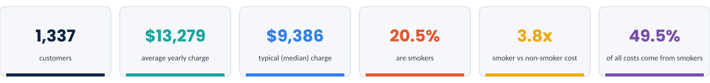
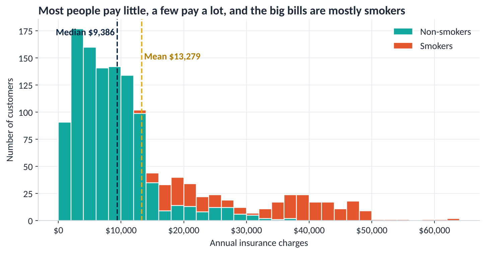
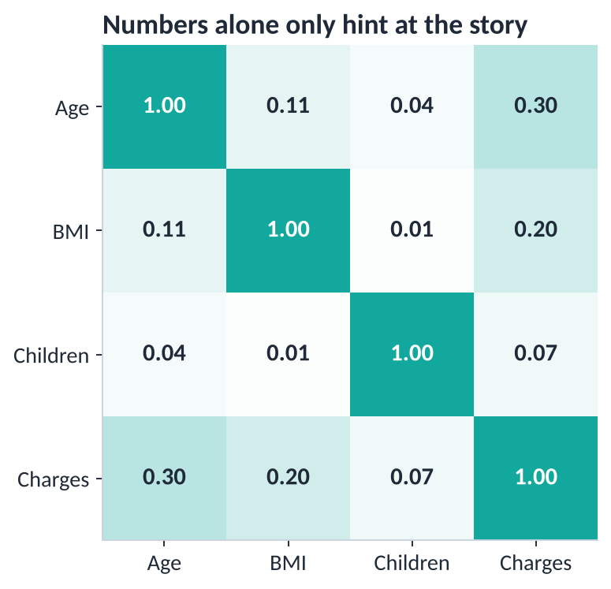
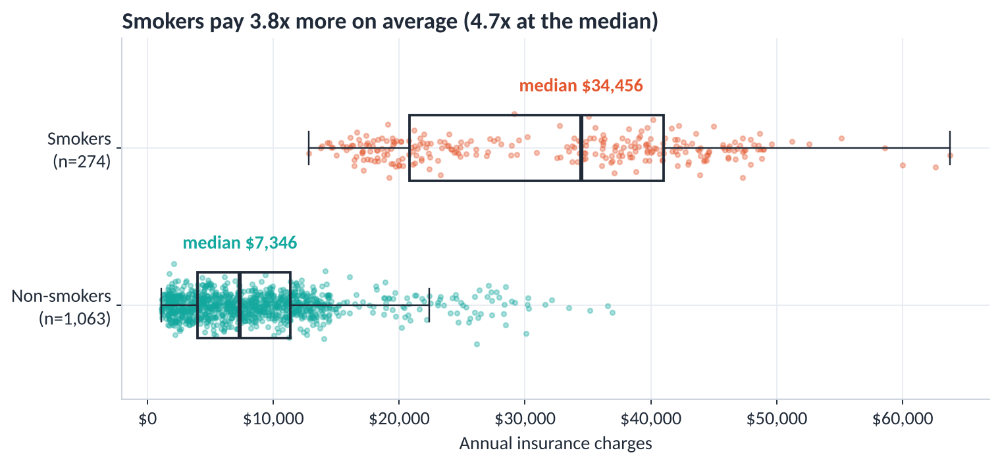
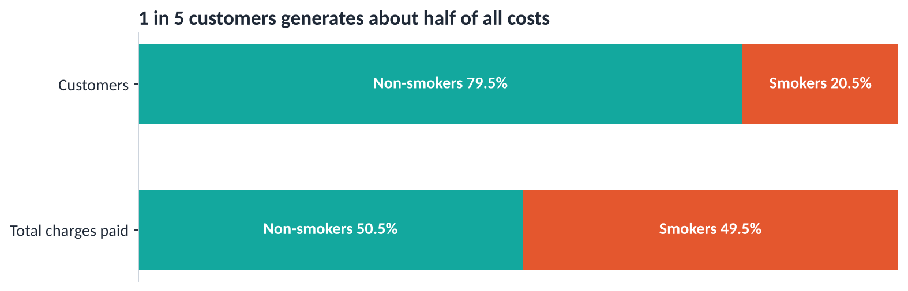
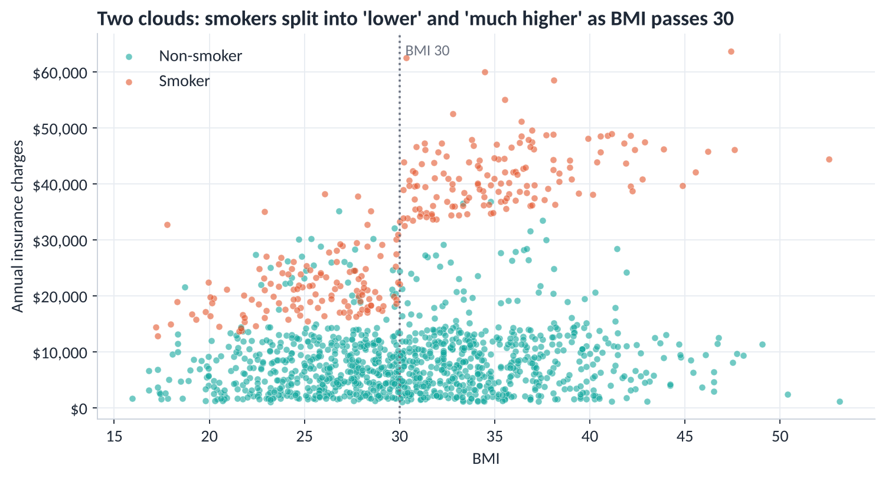
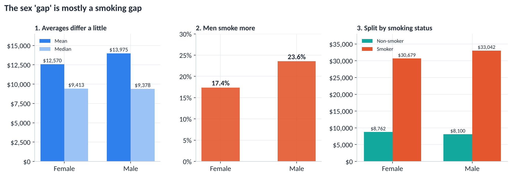

<p align="center">
  
</p>

<p align="center">
  
</p>

<p align="center">
  
</p>

> **Two customers in the same age group, 18 to 29**
>
> One pays about $4,400 a year, the other about $27,500
>
> What explains the gap? This project uses real insurance data to find out, in plain language, with a number behind every claim


## Contents

1. [The Short Answer](#1-the-short-answer)
2. [About the Project](#2-about-the-project)
3. [Data Preparation, Can We Trust the Data?](#3-data-preparation-can-we-trust-the-data)
4. [The Big Picture, Who Pays What?](#4-the-big-picture-who-pays-what)
5. [Finding 1, Smoking Is the Biggest Factor](#5-finding-1-smoking-is-the-biggest-factor)
6. [Finding 2, BMI Only Matters for Smokers](#6-finding-2-bmi-only-matters-for-smokers)
7. [Finding 3, Age Adds Cost for Everyone](#7-finding-3-age-adds-cost-for-everyone)
8. [Myths About Sex, Children and Region](#8-myths-about-sex-children-and-region)
9. [The Statistical Tests in Plain Words](#9-the-statistical-tests-in-plain-words)
10. [Test Yourself](#10-test-yourself)
11. [Conclusion](#11-conclusion)
12. [Repository and How to Run](#12-repository-and-how-to-run)


## 1. The Short Answer

If you read only one section, read this one

| # | Finding | Evidence |
|:-:|---|---|
| 1 | **Smoking is the biggest factor by far** | Smokers pay **3.8x more** on average ($32,050 vs $8,441) and **4.7x more** at the median ($34,456 vs $7,346) |
| 2 | **One in five customers creates half of all costs** | Smokers are **20.5%** of customers but **49.5%** of all charges, and **97.7%** of the 10% most expensive customers are smokers |
| 3 | **BMI matters, but only for smokers** | Nonsmokers: $7,977 for BMI under 30 and $8,856 for BMI 30 or more. Smokers: **$21,363 and $41,558**, nearly double |
| 4 | **Age adds cost for everyone** | The smoking gap stays near **$23,000 to $25,000** at every age, and a smoker aged 18 to 29 pays about **2x** a nonsmoker aged 50 to 64 ($27,518 vs $13,431) |
| 5 | **Sex, region and number of children are not the story** | No significant difference by sex (p = 0.694) or by region (p = 0.202) |

The chart below puts the main factors on one scale, so you can compare them at a glance

<p align="center">
  
</p>

> [!NOTE]
> This is an **observational** analysis
>
> It shows what goes together with higher charges, not what *causes* them, and it is not a tool for setting anyone's premium


## 2. About the Project

### 2.1 The Question

Health insurance prices look mysterious, so this project asks three simple questions

1. **How are charges related to smoking, age and BMI?**
2. **Do charges differ by sex, region or number of children?**
3. **Does the link between BMI and charges change for smokers and nonsmokers?**

It is written for anyone curious about how insurance costs work: students, beginners, and people who want to understand the numbers behind their own bills

No statistics background is needed

### 2.2 The Data

One table with **1,338 customers** and seven columns

Each row is one insured person and what they were charged for the year

| Column | What it means | Example |
|---|---|---|
| `age` | Age in years, from 18 to 64 | 19 |
| `sex` | Female or male | female |
| `bmi` | Body Mass Index, a weight to height ratio (15.96 to 53.13), where **30 or more** is the usual medical threshold for obesity | 27.9 |
| `children` | Number of dependents covered, from 0 to 5 | 0 |
| `smoker` | Does the person smoke? | yes |
| `region` | US region: northeast, northwest, southeast or southwest | southwest |
| `charges` | **The value we want to understand**, yearly medical insurance charges in USD | $16,884.92 |

<details>
<summary><b>Plain English glossary</b> (click to open)</summary>

<br>

| Term | Simple meaning |
|---|---|
| **Mean (average)** | Add everything up and divide by the number of people, one huge bill pulls it up |
| **Median (typical)** | Line everyone up from cheapest to most expensive, the median is the person in the middle, so extreme bills do not move it |
| **Correlation (r)** | A score from 0 to 1 for how closely two numbers move together in a straight line, 0 means not at all and 1 means perfectly |
| **p value** | The chance of seeing a difference this big by luck alone if there were really none, a very small value like 0.0001 means luck is unlikely |
| **Association vs causation** | "Smokers pay more" is an association, "smoking makes the price higher" is a cause, and data like this cannot prove a cause on its own |
| **Confounder** | A hidden factor that makes one thing look like it affects another |
| **Interaction** | Two factors that together do more than each one alone |

</details>


## 3. Data Preparation, Can We Trust the Data?

Before any analysis, the data went through a short checklist

| Check | Result | What was done |
|---|---|---|
| **Missing values** | **0** in every column | Nothing to fix |
| **Consistent categories** | `sex` has 2 values, `region` has 4, `children` runs from 0 to 5, no typos or odd spellings | Nothing to fix |
| **Duplicate rows** | **1 exact duplicate**, rows 195 and 581: a 19 year old nonsmoking man from the northwest charged $1,639.56 | **Removed**, so 1,338 rows became **1,337** |
| **Sensible ranges** | Age 18 to 64, BMI 15.96 to 53.13, children 0 to 5 | All realistic, nothing removed |

After cleaning the data holds **1,337 customers**: **274 smokers (20.5%)** and **1,063 nonsmokers**

> [!TIP]
> **Analyst note:** one repeated row will not change any conclusion here, but checking for duplicates every single time is the habit that keeps real analyses honest


## 4. The Big Picture, Who Pays What?

<p align="center">
  
</p>

The **average** yearly charge is **$13,279**, but the **typical** (median) customer pays only **$9,386**

Why the gap? A small group of customers has very large bills, up to **$63,770**, and they pull the average upward

Look at the colors: the **teal** nonsmokers sit on the cheap left side, while the **coral** smokers form their own second bump between $35,000 and $45,000

> [!TIP]
> **Explain it simply:** picture a class where most kids have $9 of pocket money and a few have $60
>
> The *average* looks richer than most kids really are, which is why we always check the *median* too

### What do the numbers alone say?

<table>
  <tr>
    <td width="40%" valign="middle"></td>
    <td width="60%" valign="middle">
      Looking only at the numeric columns, the links with charges are <b>modest</b>: <b>age (0.30)</b> is the strongest, then <b>BMI (0.20)</b>, and <b>children (0.07)</b> is close to nothing
      <br><br>
      This could suggest that nothing big is going on, and <b>that conclusion would be wrong</b>
      <br><br>
      A correlation only sees <i>straight line</i> patterns across <i>everyone at once</i>, so it misses stories that happen inside groups, and the next sections show where
    </td>
  </tr>
</table>


## 5. Finding 1, Smoking Is the Biggest Factor

<p align="center">
  
</p>

| | Customers | Average | Median (typical) |
|---|--:|--:|--:|
| **Nonsmokers** | 1,063 | $8,441 | $7,346 |
| **Smokers** | 274 | **$32,050** | **$34,456** |

Smokers pay **3.8 times more** on average and almost **5 times more** at the median

The two groups barely overlap: the box that holds the middle half of smokers sits to the right of nearly all nonsmokers

A Mann Whitney U test confirms this is not luck, with a p value far below 0.0001, which in practice is zero

### The cost is concentrated

<p align="center">
  
</p>

> [!IMPORTANT]
> **One in five customers creates about half of all costs**
>
> At the very top it is even clearer: of the 133 most expensive customers (the top 10%, all charged at least $35,069), **130 are smokers (97.7%)**


## 6. Finding 2, BMI Only Matters for Smokers

This is the most interesting result in the project

Each dot below is one customer

<p align="center">
  
</p>

For **nonsmokers (teal)** charges stay low and flat as BMI rises

For **smokers (coral)** a clear jump appears once BMI passes about **30**

Splitting everyone into BMI under 30 and BMI 30 or more makes the jump exact

<p align="center">
  
</p>

| Group | Customers | Average charge | Change with BMI 30 or more |
|---|--:|--:|---|
| Nonsmoker, BMI under 30 | 502 | $7,977 | |
| Nonsmoker, BMI 30 or more | 561 | $8,856 | **11% higher** |
| Smoker, BMI under 30 | 129 | $21,363 | |
| Smoker, BMI 30 or more | 145 | **$41,558** | **95% higher**, nearly double |

> [!IMPORTANT]
> **Why the correlation table missed it:** the effect of BMI depends on who you are
>
> For nonsmokers it is small, for smokers it is huge, and averaged together it looks like a weak link (0.20)
>
> Analysts call this an **interaction**

### Meet the four types of customers

<p align="center">
  
</p>

> [!TIP]
> **Analyst extra check, not in the notebook:** is this only because smokers happen to have a higher BMI?
>
> No, about **52.9%** of smokers and **52.8%** of nonsmokers have a BMI of 30 or more, so the two groups look alike on BMI
>
> The difference is in what BMI *goes together with*, not in who has it


## 7. Finding 3, Age Adds Cost for Everyone

<p align="center">
  
</p>

| Age group | Nonsmokers (average) | Smokers (average) | Gap |
|---|--:|--:|--:|
| 18 to 29 | $4,427 | $27,518 | $23,091 |
| 30 to 39 | $6,337 | $30,271 | $23,934 |
| 40 to 49 | $9,183 | $32,655 | $23,471 |
| 50 to 64 | $13,431 | $38,748 | $25,317 |

Two things stand out

1. **Charges rise with age for everyone**, and the nonsmoker average roughly **triples** from the youngest group to the oldest
2. **The smoking gap stays almost constant**, near **$23,000 to $25,000** in every age group, and as a *multiple* it shrinks (6.2x at 18 to 29, down to 2.9x at 50 to 64) only because older nonsmokers cost more

> [!IMPORTANT]
> **A young smoker costs about twice as much as an older nonsmoker**, $27,518 for ages 18 to 29 against $13,431 for ages 50 to 64
>
> In this data, smoking status outweighs decades of aging


## 8. Myths About Sex, Children and Region

### 8.1 Myth: "Men cost more than women"

<p align="center">
  
</p>

At first glance it looks *partly* true: men average **$13,975** and women **$12,570**, about **$1,405** more

A closer look changes the story

* The **median** is almost the same: **$9,378** for men and **$9,413** for women
* **Men smoke more**: **23.6%** of men against **17.4%** of women, and smokers cost much more
* Inside each smoking group there is no steady sex effect, and among nonsmokers men even pay slightly *less* ($8,100 against $8,762)

A statistical test finds **no significant difference by sex (p = 0.694)**

The gap in averages is mostly a **smoking gap in disguise**, which analysts call a **confounder**

### 8.2 Myth: "More children, higher costs"

<p align="center">
  
</p>

There is no clear pattern

Medians stay between about **$8,500 and $11,000** with no steady rise

The groups with **4 and 5 children** hold only 25 and 18 customers, which is too few to trust

### 8.3 Myth: "Where you live changes the price"

<p align="center">
  
</p>

| Region | Customers | Average | Median |
|---|--:|--:|--:|
| Northeast | 324 | $13,406 | $10,058 |
| Northwest | 324 | $12,451 | $8,977 |
| Southeast | 364 | $14,735 | $9,294 |
| Southwest | 325 | $12,347 | $8,799 |

Regions look alike, and the test agrees: **no significant difference (p = 0.202)**

The Southeast has the highest average and the widest spread of expensive cases

> [!TIP]
> **Analyst extra check, not in the notebook:** the Southeast also has the **highest share of smokers (25.0%** against 17.8% to 20.7% in the other regions)
>
> The same smoking story may sit behind this small difference


## 9. The Statistical Tests in Plain Words

Charges are very skewed, with a few huge bills, so instead of the classic t test I used **tests based on ranks**

They compare typical positions and are not distorted by extreme values the way averages are

| Question | Test | Result | In plain words |
|---|---|---|---|
| Do smokers and nonsmokers differ? | Mann Whitney U | p far below 0.0001 | Definitely, this is not luck |
| Do men and women differ? | Mann Whitney U | p = **0.694** | No significant difference |
| Do the four regions differ? | Kruskal Wallis | p = **0.202** | No significant difference |

> [!NOTE]
> "No significant difference" does **not** prove that no difference exists
>
> With 1,337 customers, small real differences could stay hidden


## 10. Test Yourself

Think first, then click to see the answer

<details>
<summary><b>Question 1: who costs more on average, a 25 year old smoker or a 55 year old nonsmoker?</b></summary>
<br>
The <b>25 year old smoker</b>, about <b>$27,518</b> against <b>$13,431</b> (age groups 18 to 29 and 50 to 64)
</details>

<details>
<summary><b>Question 2: does being a man raise your insurance cost?</b></summary>
<br>
Not by itself: the average for men is higher mainly because <b>more men smoke</b> (23.6% against 17.4%), and the medians are almost identical
</details>

<details>
<summary><b>Question 3: does a BMI of 32 instead of 25 raise the cost?</b></summary>
<br>
<b>It depends on smoking</b>: for nonsmokers only slightly (11% higher on average), for smokers it nearly doubles the average ($21,363 to $41,558)
</details>

<details>
<summary><b>Question 4: which single fact tells you the most about someone's charges?</b></summary>
<br>
Whether they <b>smoke</b>, then <b>age</b>, and then <b>BMI for smokers</b>
</details>


## 11. Conclusion

### Answers to the three questions

| Question | Answer |
|---|---|
| **1. How are charges related to smoking, age and BMI?** | **Smoking** has the clearest link (3.8x higher average), **age** raises charges for everyone, and **BMI** matters mostly for smokers |
| **2. Do charges differ by sex, region or children?** | **No clear difference**: sex and region are not significant (p = 0.694 and 0.202) and children show no pattern |
| **3. Does the BMI link change for smokers and nonsmokers?** | **Yes, strongly**: 11% higher for nonsmokers with BMI 30 or more, and 95% higher for smokers |

### What this suggests

* To understand insurance costs, **start with smoking status**
* Look at **combinations of factors** and not one at a time, because the BMI story only appears when you split by smoking
* Always ask **"what else could explain this?"** before believing a gap, as the sex example shows

### Limitations

* **Small, single snapshot:** 1,337 customers at one point in time, and groups like 4 or 5 children are tiny
* **No health history:** conditions, treatments and lifestyle details are unknown
* **Association, not cause:** the data cannot prove that smoking *causes* higher charges
* **Not for pricing:** the findings describe patterns and are not a way to set a person's premium

### What comes next

This notebook is the **analysis** half of the project

The next step is a separate **machine learning notebook** that tests whether a model can predict charges, and whether it finds the same smoking and BMI interaction on its own


## 12. Repository and How to Run

```text
Insurance_Analysis_Project/
├── Insurance_Analysis.ipynb        # The full analysis: cleaning, charts, tests, summary
├── insurance.csv                   # The dataset (1,338 rows before cleaning)
├── README.md                       # This file
├── Plots/                          # 11 charts used in this README
├── assets/                         # Banner, tool strip, key numbers, dividers, customer types
└── scripts/
    ├── build_visuals.py            # Rebuilds the notebook charts from the data
    └── build_readme_assets.py      # Rebuilds the README images and the summary chart
```

**Run it yourself**


<p align="center"><sub>Dataset: Medical Cost Personal Dataset (insurance.csv), analysis for educational and portfolio purposes</sub></p>