<div align="center">
  
  <br>
  <strong>Exploratory Data Analysis</strong>
  <br>
  <span>Understanding how customer characteristics are associated with medical insurance charges</span>
  <br><br>
  
</div>


<br><br>


<br><br>

The cost of medical insurance is not the same for every customer.
This analysis explores a medical insurance dataset to understand how annual charges vary across customer profiles.

The work focuses on **age**, BMI, **smoking status**, **sex**, **number of children**, and **region**.
The goal is to move from a first look at the data to clear comparisons, useful patterns, and statistical evidence.

The main question behind the project is simple.

> **Which customer characteristics show the clearest relationship with annual medical insurance charges?**

The analysis is observational, so the results describe patterns in this dataset and do not prove that one characteristic causes a specific insurance charge.

<br><br>

<br><br>


The original dataset contains **1,338 records** and **7 columns**.
One exact duplicate row was found and removed, leaving **1,337 unique customer records** for the analysis.

<div align="center">
  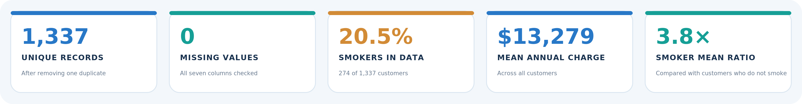
</div>

### Dataset fields

| Measure | `age` | `sex` | `bmi` | `children` | `smoker` | `region` | `charges` |
|:-:|:-:|:-:|:-:|:-:|:-:|:-:|:-:|
| ``Description`` | Customer age in years | Customer sex, recorded as female or male | Body Mass Index | Number of children covered | Smoking status, recorded as yes or no | Customer region in the United States | Annual medical insurance charges in US dollars |
| ``Data type`` | Numerical | Categorical | Numerical | Numerical | Categorical | Categorical | Numerical outcome |

### Data quality checks

| Measure | Original records | Exact duplicate rows | Records after duplicate removal | Missing values | Sex categories | Smoking categories | Regions | Child count values |
|:-:|:-:|:-:|:-:|:-:|:-:|:-:|:-:|:-:|
| Result | 1,338 | 1 | **1,337** | **0** | 2 | 2 | 4 | 6 |
| What it means | Rows in the source CSV file | One repeated record was identified | Final dataset used for the analysis | No imputation was required | Female and male | Yes and no | Northeast, northwest, southeast and southwest | Values from 0 to 5 |

The category checks did not reveal unexpected values in the columns reviewed.
The duplicate was removed before the main analysis, and the cleaned dataframe was used for the group comparisons and statistical tests.

<br><br>

<br><br>


The notebook follows a practical exploratory analysis process.
<br><br>

<div align="center">
  
</div>

<br><br>


| Stage | Inspect | Clean | Explore | Compare | Investigate further | Test |
|:-:|:-:|:-:|:-:|:-:|:-:|:-:|
| Work completed | Reviewed sample rows, column types, descriptive statistics and category values | Checked missing values, identified the repeated row and removed the duplicate | Studied the overall charges distribution and numerical correlations | Compared charges across sex, smoking status, number of children and region | Examined BMI and age patterns within smoking groups | Used Mann Whitney U and Kruskal Wallis tests for selected group comparisons |

<br><br>

<br><br>


### 4.1 | Overall Distribution of Insurance Charges

The cleaned dataset has an average annual charge of **$13,279.12** and a median of **$9,386.16**.
The standard deviation is **$12,110.36**, which shows that charges vary widely between customers.

| Measure | Records | Mean | Median | Standard deviation | First quartile | Third quartile | Minimum | Maximum | Skewness |
|:--|--:|--:|--:|--:|--:|--:|--:|--:|--:|
| Charge | 1,337 | **$13,279.12** | **$9,386.16** | $12,110.36 | $4,746.34 | $16,657.72 | $1,121.87 | $63,770.43 | **1.51** |

<div align="center">
  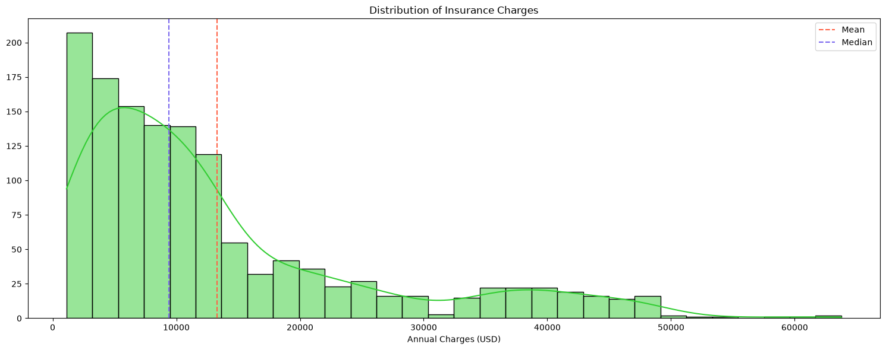
  <em>Figure 1 | Distribution of annual charges with the mean and median marked</em>
</div>

* 

The distribution is **right skewed**.  
Most customers are concentrated in the lower charge ranges, while a smaller group has much higher annual charges.  
These high values pull the mean above the median by about **$3,892.96**.  
For this reason, the median gives a more useful description of the middle customer than the mean alone.  


### 4.2 | Numerical Relationships

The correlation matrix compares the linear relationship between the numerical features and annual charges.
The values below were recalculated using the final dataset after duplicate removal.

| Feature | Correlation with charges | Reading |
|:--|--:|:--|
| **Age** | **0.2983** | Weak to moderate positive relationship |
| BMI | **0.1984** | Weak positive relationship |
| **Children** | **0.0674** | Very weak positive relationship |


<div align="center">
  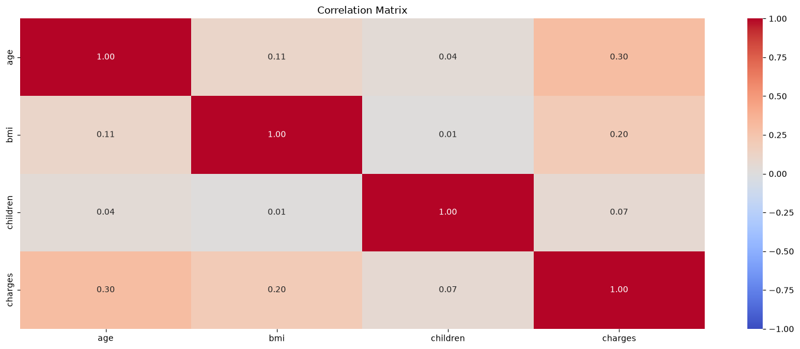
  <em>Figure 2 | Correlation matrix for the numerical features</em>
</div>  

* 

Age has the strongest linear relationship with charges among the numerical features checked.  
The positive value means that older customers tend to have higher charges in this dataset, but not strong enough to explain charges on its own.
BMI has a smaller positive correlation with charges.  
The relationship between BMI and charges becomes more interesting when smoking status is examined separately, which is explored later in this analysis.  
Number of children has almost no linear correlation with charges.  
This does not rule out differences between individual child count groups, but it suggests that a simple linear relationship is very weak.  
Correlation measures association, not cause and effect.
It also does not control for the other features in the dataset.


### 4.3 | Charges by Sex

The dataset contains **662 female customers** and **675 male customers**.
The average charge is higher for males, but the median charges are almost identical.

| Group | Customers | Mean charge | Median charge |
|:--|--:|--:|--:|
| Female | 662 | $12,569.58 | $9,412.96 |
| Male | 675 | $13,975.00 | $9,377.90 |

The difference between the group averages is about **$1,405.42**, while the median difference is only about **$35.06**.
The boxplot and violin plot also show substantial overlap between the two groups.

<table>
  <tr>
    <td width="50%">
      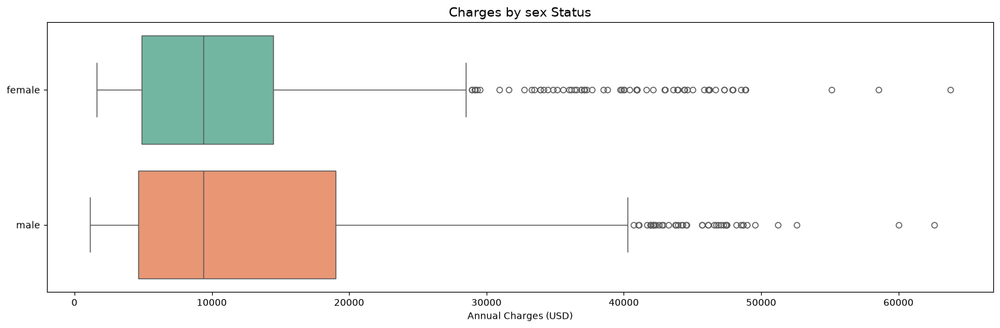
      <p align="center"><em>Figure 3 | Charges by sex using a boxplot</em></p>
    </td>
    <td width="50%">
      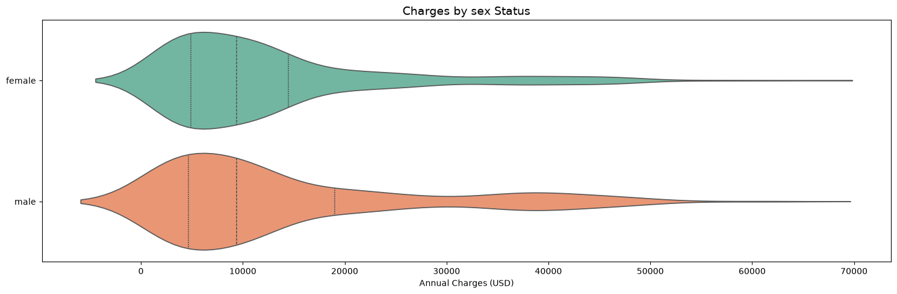
      <p align="center"><em>Figure 4 | Charges by sex using a violin plot</em></p>
    </td>
  </tr>
</table>

``
The Mann Whitney U test returned a p value of **0.694**.  
At the 0.05 significance level, this test does not provide evidence of a statistically significant difference between the two charge distributions.  
The result does not prove that sex has no relationship with charges.  
The smoking composition of each group is examined later because it provides useful context for the difference in averages.  
``

### 4.4 | Charges by Smoking Status

Smoking status shows the **clearest separation** in the exploratory analysis.
There are **1,063 customers who do not smoke** and **274 customers who smoke**.

| Smoking group | Customers | Mean charge | Median charge |
|:--|--:|--:|--:|
| Does not smoke | 1,063 | $8,440.66 | $7,345.73 |
| Smokes | 274 | **$32,050.23** | **$34,456.35** |

The average charge for customers who smoke is about **``3.8 times``** the average for customers who do not smoke.  
The difference between the two averages is approximately **``$23,609.57``**.  
The median difference is even larger, at approximately **``$27,110.62``**.  

<table>
  <tr>
    <td width="50%">
      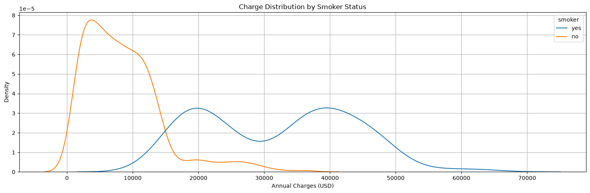
      <p align="center"><em>Figure 5 | Charge distributions for the two smoking groups</em></p>
    </td>
    <td width="50%">
      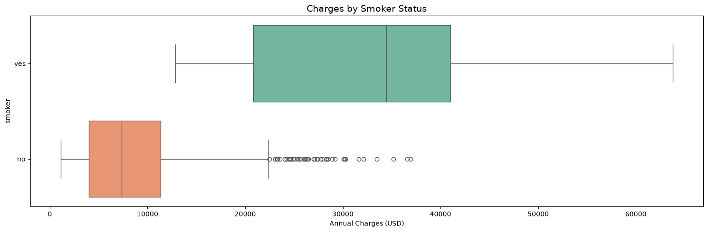
      <p align="center"><em>Figure 6 | Charges by smoking status using a boxplot</em></p>
    </td>
  </tr>
</table>

<div align="center">
  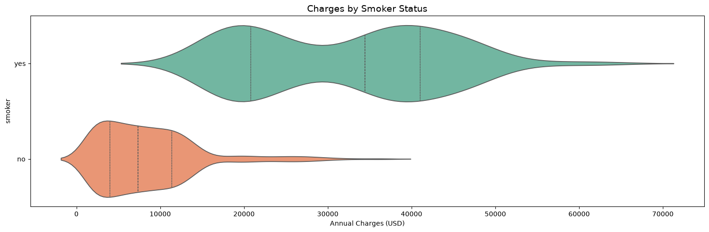
  <p align="center"><em>Figure 7 | The shape and spread of charges in each smoking group</em></p>
</div>


The plots show that the charge distribution for customers who smoke is shifted toward much higher values.  
This difference is also supported by the Mann Whitney U test, which returned a p value of **( 5.75 × 10⁻¹³⁰ )**.  
This is strong statistical evidence that the charge distributions differ between the two smoking groups.

Smoking status is therefore the most important group distinction observed in this analysis.
However, this is still an observational result and does not show that smoking alone explains the difference.


### 4.5 | Charges by Number of Children

The number of children does not show a clear increasing or decreasing pattern in charges.
The group averages and medians vary, rather than following a steady trend.

| Measure | 0 | 1 | 2 | 3 | 4 | 5 |
|:--|:-:|:-:|:-:|:-:|:-:|:-:|
| Customers | 573 | 324 | 240 | 157 | 25 | 18 |
| Mean charge | $12,384.70 | $12,731.17 | $15,073.56 | $15,355.32 | $13,850.66 | $8,786.04 |
| Median charge | $9,863.47 | $8,483.87 | $9,264.98 | $10,600.55 | $11,033.66 | $8,589.57 |


<div align="center">
  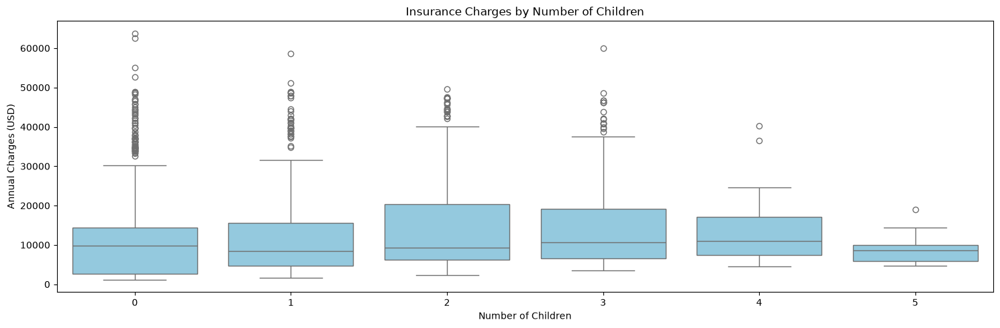
  <em>Figure 8 | Charge distributions across the number of children</em>
</div>

* 
 
The groups with four and five children contain only **25** and **18** customers.  
Their results are less stable than the larger groups and should be interpreted carefully.  
The very small correlation value of **0.0674** supports the conclusion that the number of children has little linear association with charges in this dataset.  
  

### 4.6 | Charges by Region

The data contains customers from four regions, with group sizes ranging from **324** to **364** records.
The median charges are fairly close across regions, even though the average charges are not identical.

| Region | Customers | Mean charge | Median charge |
|:--|--:|--:|--:|
| Northeast | 324 | $13,406.38 | $10,057.65 |
| Northwest | 324 | $12,450.84 | $8,976.98 |
| Southeast | 364 | $14,735.41 | $9,294.13 |
| Southwest | 325 | $12,346.94 | $8,798.59 |

<table>
  <tr>
    <td width="50%">
      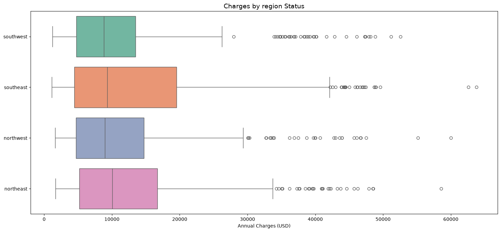
      <p align="center"><em>Figure 9 | Regional charge distributions</em></p>
    </td>
    <td width="50%">
      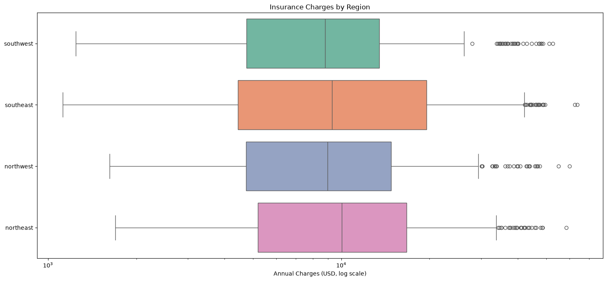
      <p align="center"><em>Figure 10 | The same regional comparison on a logarithmic scale</em></p>
    </td>
  </tr>
</table>

The Southeast has the highest average charge and a wider spread, but its median is close to the medians of the other regions.  
The Kruskal Wallis test returned a p value of **0.202**.  
At the 0.05 significance level, the test does not provide evidence of a statistically significant difference across the four regional charge distributions.

The logarithmic scale in Figure 10 makes the lower and higher values easier to view together.  
It changes the visual spacing of the axis, not the underlying customer charges.  

### 4.7 | BMI and Charges Within Smoking Groups

The scatter plot suggests that the relationship between BMI and charges does not look the same for customers who smoke and customers who do not smoke.  
To explore this pattern, BMI was divided into two groups for comparison: **below 30** and **30 or above**.

| Smoking group | BMI group | Customers | Mean charge | Median charge |
|:--|:--|--:|--:|--:|
| Does not smoke | Below 30 | 502 | $7,977.03 | $6,761.62 |
| Does not smoke | 30 or above | 561 | $8,855.53 | $8,083.92 |
| Smokes | Below 30 | 129 | $21,363.22 | $20,167.34 |
| Smokes | 30 or above | 145 | **$41,557.99** | **$40,904.20** |

<table>
  <tr>
    <td width="50%">
      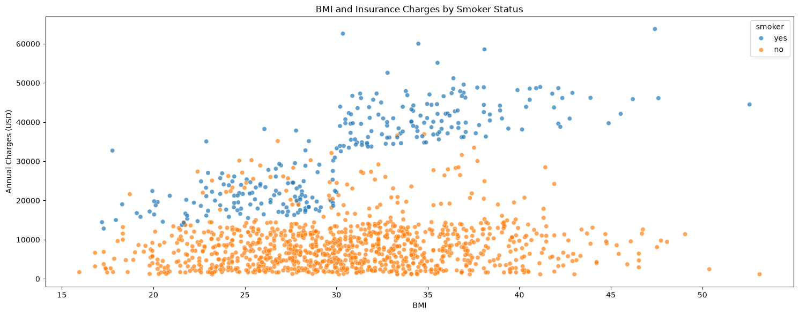
      <p align="center"><em>Figure 11 | BMI and charges by smoking status</em></p>
    </td>
    <td width="50%">
      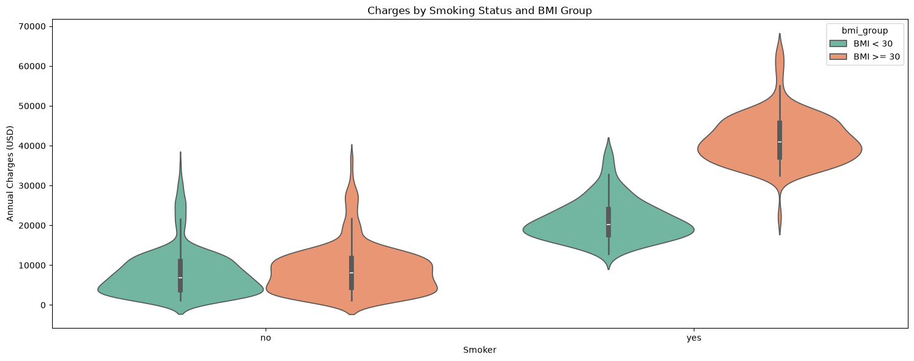
      <p align="center"><em>Figure 12 | Charge distributions across the four BMI and smoking groups</em></p>
    </td>
  </tr>
</table>

Among customers who do not smoke, the median charge rises from **$6,761.62** to **$8,083.92** between the two BMI groups.  
Among customers who smoke, it rises from **$20,167.34** to **$40,904.20**.  
The median in the higher BMI group is therefore about **2.0 times** the median in the lower BMI group among customers who smoke.  

This is a notable descriptive pattern in the current dataset.  
It should not be interpreted as proof of an interaction or a causal effect because no adjusted interaction model was tested in this exploratory section.  
The BMI split is used only to make the comparison easier to read and should not be treated as a medical diagnosis.  

### 4.8 | Age and Charges Within Smoking Groups

Age has the strongest positive correlation with charges among the numerical features.  
The scatter plot and age group comparison show how this pattern appears within each smoking group.  

| Age group | Customers who do not smoke | Median charge | Customers who smoke | Median charge |
|:--|--:|--:|--:|--:|
| 18 to 29 | 330 | $2,709.18 | 86 | $33,604.25 |
| 30 to 39 | 199 | $5,400.98 | 58 | $34,112.91 |
| 40 to 49 | 217 | $8,240.59 | 62 | $36,449.55 |
| 50 to 64 | 317 | $12,029.29 | 68 | $43,696.40 |

<table>
  <tr>
    <td width="50%">
      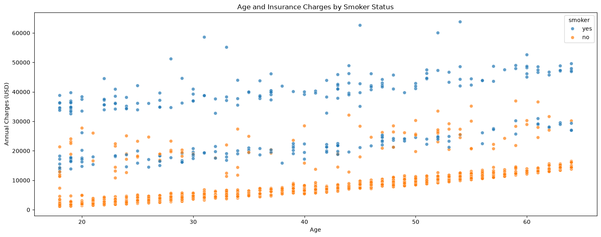
      <p align="center"><em>Figure 13 | Age and annual charges by smoking status</em></p>
    </td>
    <td width="50%">
      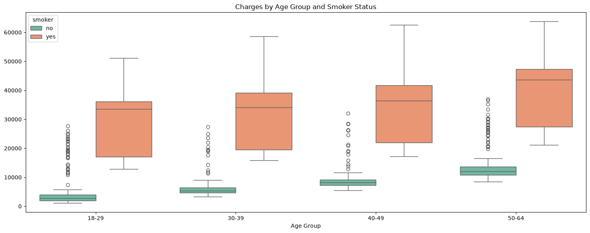
      <p align="center"><em>Figure 14 | Charge distributions across age and smoking groups</em></p>
    </td>
  </tr>
</table>

Median charges rise across the age groups for customers who smoke and for customers who do not smoke.  
Customers who smoke have much higher median charges in every age group shown.  
This supports the earlier finding that age and smoking status are both useful characteristics for understanding charge patterns in this dataset.  

### 4.9 | Understanding the Overall Sex Difference

The overall average charge is about **$1,405 higher for males**, but the smoking proportions are also different between the two groups.

| Sex | Customers who do not smoke | Customers who smoke | Smoking share |
|:--|--:|--:|--:|
| Female | 547 | 115 | 17.4% |
| Male | 516 | 159 | 23.6% |

The group averages also change when customers are compared within smoking status.  
Among customers who do not smoke, the average is **$8,762.30** for females and **$8,099.70** for males.  
Among customers who smoke, the average is **$30,679.00** for females and **$33,042.01** for males.  

This shows why the overall difference by sex should not be interpreted on its own.  
The proportion of customers who smoke is higher in the male group, and the two smoking groups have very different charge levels.  
The notebook does not run a multivariable model here, so this comparison is descriptive rather than an adjusted estimate.  

<br><br>

<br><br>


The notebook uses non parametric tests for selected group comparisons.  
These tests compare the ranks of the observed charges and do not require the charge values to follow a normal distribution.  
The significance threshold used for interpretation is **0.05**.  

| Question | Statistical test | Test statistic | p value | Interpretation at 0.05 |
|:--|:--|--:|--:|:--|
| Do charges differ by smoking status? | Mann Whitney U | 283,859 | **5.75 × 10⁻¹³⁰** | Strong evidence of a difference |
| Do charges differ by sex? | Mann Whitney U | 226,198 | 0.694 | No statistically significant difference detected |
| Do charges differ by region? | Kruskal Wallis | 4.623 | 0.202 | No statistically significant difference detected |

The smoking comparison has an extremely small p value, which supports the clear separation seen in the plots.  
The tests for sex and region do not provide sufficient evidence of a difference at the selected threshold.  
A result that is not statistically significant does not prove that two groups are identical.  
 
These tests cover selected comparisons only.  
They do not adjust for other customer characteristics, measure the causal effect of a feature, or replace a multivariable analysis.  

<br><br>

<br><br>


<table>
  <tr>
    <td width="33%" valign="top">
      <strong><span style="color:#168A87">SMOKING STATUS</span></strong>
      <br><br>
      Customers who smoke have an average charge about <strong>3.8 times</strong> that of customers who do not smoke.
      This is the clearest difference found in the analysis.
    </td>
    <td width="33%" valign="top">
      <strong><span style="color:#2878C7">AGE</span></strong>
      <br><br>
      Age has the <strong>strongest positive correlation</strong> with charges among the numerical features, and median charges rise across the age groups.
    </td>
    <td width="33%" valign="top">
      <strong><span style="color:#B8792D">BMI</span></strong>
      <br><br>
      The difference between BMI groups is much more noticeable among customers who smoke in the descriptive comparison.
    </td>
  </tr>
  <tr>
    <td valign="top">
      <strong><span style="color:#2878C7">SEX</span></strong>
      <br><br>
      The overall means differ, but the medians are nearly equal and the selected statistical test is not significant.
    </td>
    <td valign="top">
      <strong><span style="color:#168A87">REGION</span></strong>
      <br><br>
      Regional medians are broadly similar, and the Kruskal Wallis test does not detect a significant difference.
    </td>
    <td valign="top">
      <strong><span style="color:#6C69C8">CHILDREN</span></strong>
      <br><br>
      The number of children has a very weak linear correlation with charges, with small groups at four and five children.
    </td>
  </tr>
</table>

<br><br>


**The dataset is observational.** :
The patterns show associations and cannot establish that a customer characteristic causes a higher or lower charge.

**The dataset has limited information.** :
It includes age, sex, BMI, number of children, smoking status and region, but it does not include detailed health history or many other possible influences on insurance costs.

**Some groups are small.** : 
Only 25 customers have four children and 18 customers have five children, so those comparisons are less reliable.

**The analysis is not adjusted.** :
Most comparisons are group summaries or pairwise statistical tests, so they do not separate the effect of one characteristic from the others.

**Statistical significance is not the same as practical importance.** :
A p value gives evidence about a group difference under a statistical test, but it does not explain why the difference exists or whether it is useful for an individual decision.

**The BMI groups are exploratory.** :
The split at 30 is used for a simple comparison in this notebook and is not a medical conclusion.

The results should be used to understand the dataset and guide further analysis, not to set an individual customer's insurance premium.

<br><br>


````
Medical-Insurance/
│
├── Analysis_Plots/
│   ├── 01_charges_distribution.png
│   ├── 02_numerical_feature_correlation.png
│   └── ...  # Other plot images
│
├── assets/
│   ├── hero_banner.png
│   ├── tools.png
│   └── ...  # Other project images
│
├── insurance.csv
├── Insurance_Analysis.ipynb
├── Insurance_Predictions.ipynb
└── README.md`
````