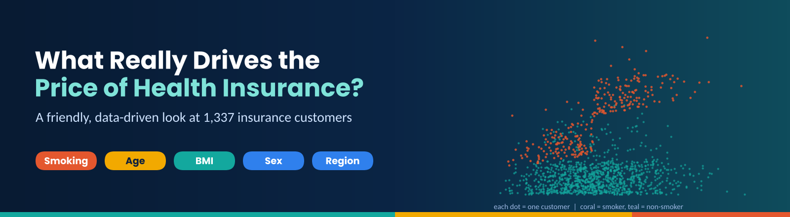
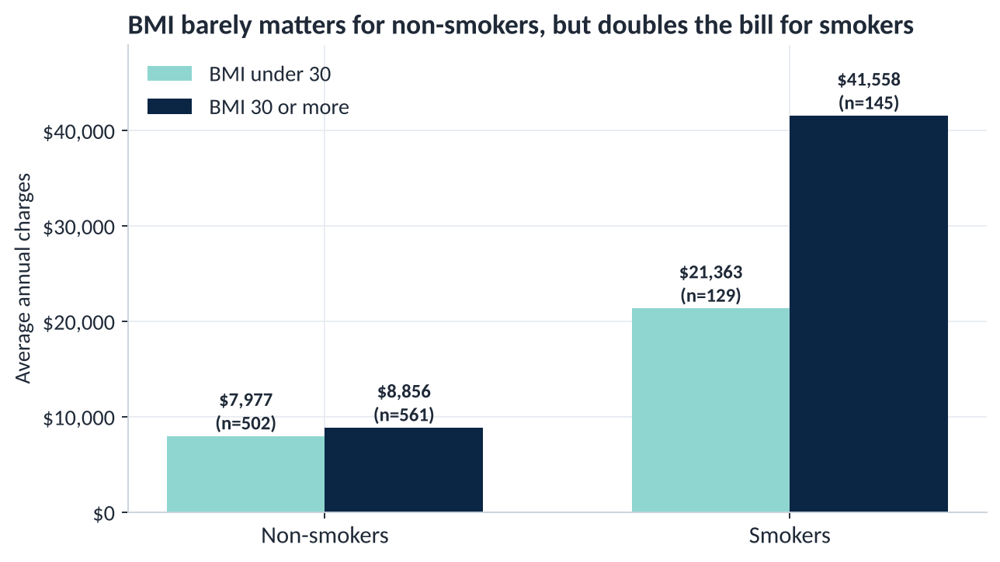
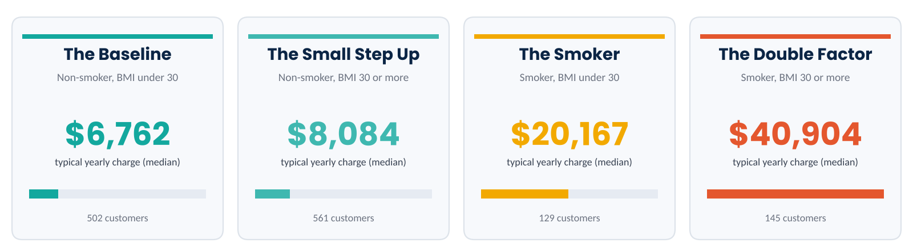
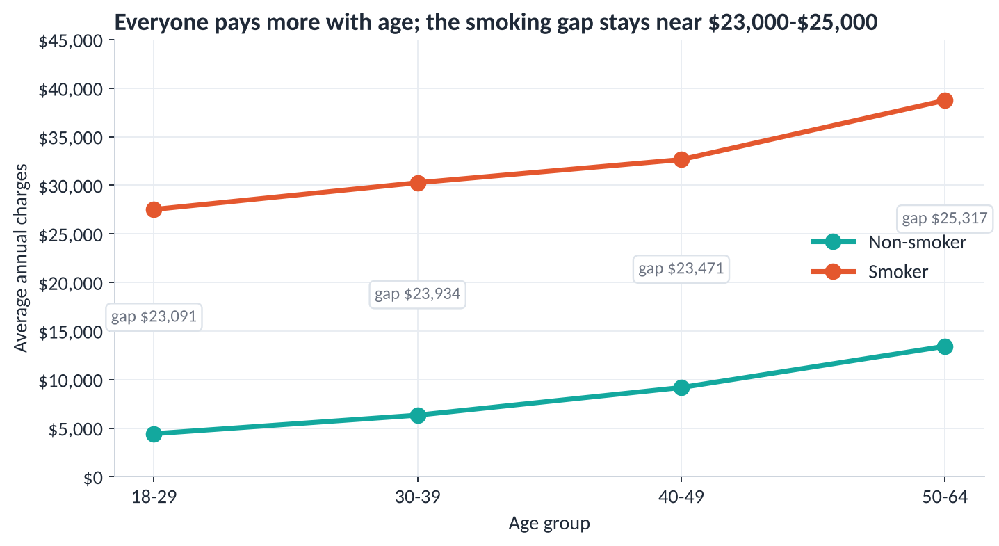
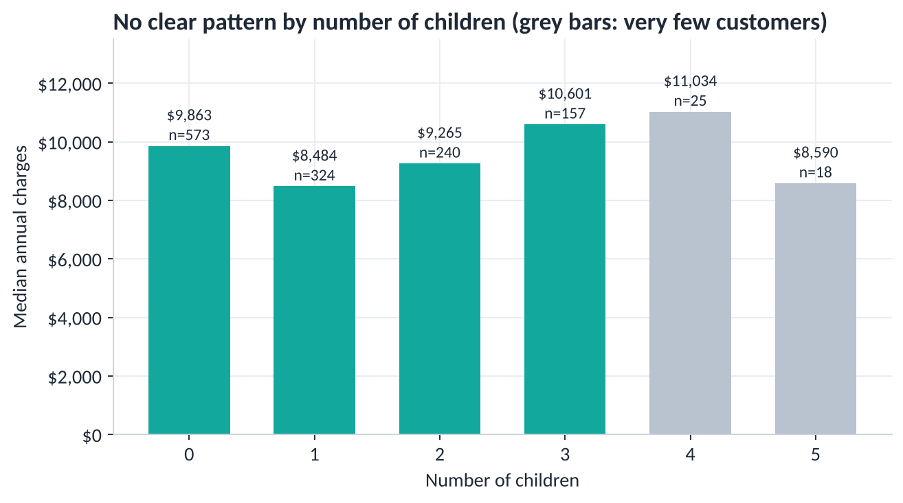
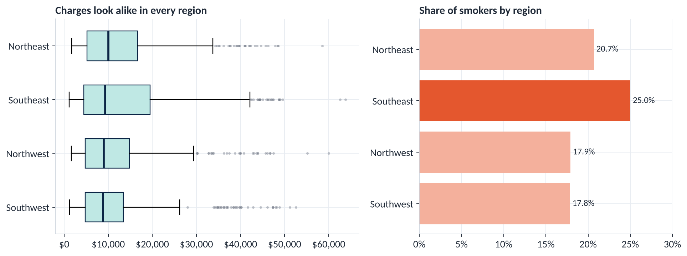

<p align="center">
  
</p>

<p align="center">
  
  
  
  
  
</p>

<p align="center">
  
</p>

# What Really Drives the Price of Health Insurance?

> **Two customers. Same age group (18 to 29). One pays about $4,400 a year, the other about $27,500.**
> What is different? This project uses real insurance data to find out, in plain language, with every claim backed by a number.


## Contents

- [1. The 60-Second Version](#1-the-60-second-version)
- [2. Project Overview](#2-project-overview)
  - [2.1 The Question](#21-the-question)
  - [2.2 The Data](#22-the-data)
- [3. Data Preparation: Can We Trust the Data?](#3-data-preparation-can-we-trust-the-data)
- [4. The Big Picture: Who Pays What?](#4-the-big-picture-who-pays-what)
  - [What about the numbers alone?](#what-about-the-numbers-alone)
- [5. Finding #1: Smoking Is the Biggest Factor](#5-finding-1-smoking-is-the-biggest-factor)
  - [The cost is concentrated](#the-cost-is-concentrated)
- [6. Finding #2: BMI Only Matters for Smokers](#6-finding-2-bmi-only-matters-for-smokers)
  - [Meet the four types of customers](#meet-the-four-types-of-customers)
- [7. Finding #3: Age Adds Cost for Everyone](#7-finding-3-age-adds-cost-for-everyone)
- [8. Myth-Busters: Sex, Children and Region](#8-myth-busters-sex-children-and-region)
  - [8.1 Myth: "Men cost more than women"](#81-myth-men-cost-more-than-women)
  - [8.2 Myth: "More children, higher costs"](#82-myth-more-children-higher-costs)
  - [8.3 Myth: "Where you live changes the price"](#83-myth-where-you-live-changes-the-price)
- [9. The Statistical Tests, in Plain Words](#9-the-statistical-tests-in-plain-words)
- [10. Test Yourself](#10-test-yourself)
- [11. Conclusion](#11-conclusion)
  - [Answers to the three questions](#answers-to-the-three-questions)
  - [What this suggests](#what-this-suggests)
  - [Limitations](#limitations)
  - [What comes next](#what-comes-next)
- [12. Repository Structure and How to Run](#12-repository-structure-and-how-to-run)


## 1. The 60-Second Version

If you read nothing else, read this:

| # | What we found | The proof |
|:-:|---|---|
| 1 | **Smoking is the biggest factor, by far.** | Smokers pay **3.8x more** on average ($32,050 vs $8,441) and **4.7x more** at the median ($34,456 vs $7,346). |
| 2 | **1 in 5 customers creates half of all costs.** | Smokers are **20.5%** of customers but **49.5%** of all charges. Among the 10% most expensive customers, **97.7%** are smokers. |
| 3 | **BMI matters, but only for smokers.** | Non-smokers: $7,977 vs $8,856 (BMI under 30 vs 30+). Smokers: **$21,363 vs $41,558**, nearly double. |
| 4 | **Age adds cost for everyone.** The smoking gap stays near **$23,000 to $25,000** at every age. | A smoker aged 18 to 29 pays about **2x** a non-smoker aged 50 to 64 ($27,518 vs $13,431). |
| 5 | **Sex, region and number of children are not the story.** | Tests found no significant difference by sex (p = 0.694) or region (p = 0.202). |

> [!NOTE]
> This is an **observational** analysis. It shows what goes together with higher charges, not what *causes* them, and it is not a tool for setting anyone's premium.


## 2. Project Overview

### 2.1 The Question

Health insurance prices look mysterious. This project asks three simple questions:

1. **How are charges related to smoking, age and BMI?**
2. **Do charges differ by sex, region or number of children?**
3. **Does the link between BMI and charges differ for smokers and non-smokers?**

It is written for **anyone curious about how insurance costs work**: students, beginners, and people who simply want to understand the numbers behind their own bills. No statistics background needed.

### 2.2 The Data

One table, **1,338 customers**, seven columns. Each row is one insured person and what they were charged for the year.

| Column | What it means | Example |
|---|---|---|
| `age` | Age in years (18 to 64) | 19 |
| `sex` | Female or male | female |
| `bmi` | Body Mass Index, a height-to-weight ratio (15.96 to 53.13). **30 or more** is the usual medical threshold for obesity. | 27.9 |
| `children` | Number of dependents covered (0 to 5) | 0 |
| `smoker` | Does the person smoke? | yes |
| `region` | US region: northeast, northwest, southeast, southwest | southwest |
| `charges` | **What we want to understand:** yearly medical insurance charges in USD | $16,884.92 |

<details>
<summary><b>Plain-English glossary</b> (click to expand)</summary>

<br>

| Term | Simple meaning |
|---|---|
| **Mean (average)** | Add everything up and divide by the number of people. One huge bill pulls it up. |
| **Median ("typical")** | Line everyone up from cheapest to most expensive; the median is the person in the middle. It is not pulled by extreme bills. |
| **Correlation (r)** | A score from 0 to 1 for how closely two numbers move together in a straight line. 0 = not at all, 1 = perfectly. |
| **p-value** | The chance of seeing a difference this big *by luck alone* if there were really none. Very small (like 0.0001) = unlikely to be luck. |
| **Association vs causation** | "Smokers pay more" is an association. "Smoking makes the price higher" would be a cause, and data like this cannot prove it by itself. |

</details>


## 3. Data Preparation: Can We Trust the Data?

Before any analysis, the data was checked. A short, honest checklist:

| Check | Result | What was done |
|---|---|---|
| **Missing values** | **0** in every column | Nothing to fix. |
| **Consistent categories** | `sex` has 2 values, `region` has 4, `children` runs 0 to 5, with no typos or odd spellings | Nothing to fix. |
| **Duplicate rows** | **1 exact duplicate** (rows 195 and 581: a 19-year-old non-smoking man from the northwest, $1,639.56) | **Removed.** 1,338 rows became **1,337**. |
| **Sensible ranges** | Age 18 to 64, BMI 15.96 to 53.13, children 0 to 5 | All plausible, nothing removed. |

After cleaning: **1,337 customers**, of which **274 smoke (20.5%)** and **1,063 do not**.

> [!TIP]
> **Analyst's note: the duplicate matters less than the habit.** One repeated row will not change any conclusion here, but checking for duplicates *every time* is what keeps real-world analyses honest.


## 4. The Big Picture: Who Pays What?

<p align="center">
  
</p>

The **average** yearly charge is **$13,279**, but the **typical** (median) customer pays only **$9,386**. Why the gap? A minority of customers have very large bills (up to **$63,770**) that drag the average upward.

Look at the colors: the **teal** non-smokers cluster on the cheap left side, while the **coral** smokers create their own second bump around $35,000 to $45,000.

> [!TIP]
> **Explain it like I'm 12:** imagine a class where most kids have $9 of pocket money, but a few have $60. The *average* looks richer than most kids really are. That is why we always check the *median* too.

### What about the numbers alone?

<table>
  <tr>
    <td width="40%" valign="middle"></td>
    <td width="60%" valign="middle">
      Looking only at the number columns, the links to charges are <b>modest</b>: <b>age (0.30)</b> is the strongest, then <b>BMI (0.20)</b>, and <b>children (0.07)</b> is nearly nothing.
      <br><br>
      This could suggest nothing big is going on. <b>It would be a wrong conclusion.</b> A correlation only sees <i>straight-line</i> patterns across <i>everyone at once</i>, so it misses stories that happen inside groups. The next sections show why.
    </td>
  </tr>
</table>


## 5. Finding #1: Smoking Is the Biggest Factor

<p align="center">
  
</p>

| | Customers | Average | Median ("typical") |
|---|--:|--:|--:|
| **Non-smokers** | 1,063 | $8,441 | $7,346 |
| **Smokers** | 274 | **$32,050** | **$34,456** |

**Smokers pay 3.8 times more on average**, and almost **5 times more** at the median. The two groups barely overlap: the box showing the middle half of smokers sits to the right of nearly all non-smokers.

A statistical test (Mann-Whitney) confirms this is not luck: **p = 5.75e-130**, which is effectively zero.

### The cost is concentrated

<p align="center">
  
</p>

> [!IMPORTANT]
> **1 in 5 customers generates about half of all costs.** And at the very top: of the 133 most expensive customers (the top 10%, all charged at least $35,069), **130 are smokers (97.7%)**.


## 6. Finding #2: BMI Only Matters for Smokers

This is the most interesting result in the project. Each dot below is a customer:

<p align="center">
  
</p>

For **non-smokers (teal)**, charges stay low and flat as BMI rises. For **smokers (coral)**, a clear jump appears once BMI passes about **30**. Splitting everyone into "BMI under 30" and "BMI 30 or more" makes it exact:

<p align="center">
  
</p>

| Group | Customers | Average charge | What changes with BMI 30+ |
|---|--:|--:|---|
| Non-smoker, BMI under 30 | 502 | $7,977 | |
| Non-smoker, BMI 30 or more | 561 | $8,856 | **+11%** |
| Smoker, BMI under 30 | 129 | $21,363 | |
| Smoker, BMI 30 or more | 145 | **$41,558** | **+95%** (nearly double) |

> [!IMPORTANT]
> **Why the correlation table missed it:** BMI's effect depends on *who* you are. For non-smokers it is small; for smokers it is huge. Averaged together, it looks like a weak link (0.20). Analysts call this an **interaction**: two factors that together do more than each alone.

### Meet the four types of customers

<p align="center">
  
</p>

> [!TIP]
> **Analyst's extra check (not in the notebook):** is this just because smokers happen to have higher BMI? No. About **52.9%** of smokers and **52.8%** of non-smokers have a BMI of 30 or more, so the two groups are alike on BMI. The difference is in what BMI *goes together with*, not in who has it.


## 7. Finding #3: Age Adds Cost for Everyone

<p align="center">
  
</p>

| Age group | Non-smokers (avg) | Smokers (avg) | Gap |
|---|--:|--:|--:|
| 18 to 29 | $4,427 | $27,518 | $23,091 |
| 30 to 39 | $6,337 | $30,271 | $23,934 |
| 40 to 49 | $9,183 | $32,655 | $23,471 |
| 50 to 64 | $13,431 | $38,748 | $25,317 |

Two things stand out:

1. **Charges rise with age for everyone.** Non-smokers' average roughly **triples** from the youngest to the oldest group.
2. **The smoking gap is almost constant**, about **$23,000 to $25,000** in every age group. As a *multiple* it shrinks (6.2x for 18 to 29, down to 2.9x for 50 to 64) only because older non-smokers cost more.

> [!IMPORTANT]
> **A 20-something smoker costs about twice as much as a 55-year-old non-smoker** ($27,518 vs $13,431 on average). In this data, smoking status outweighs decades of aging.


## 8. Myth-Busters: Sex, Children and Region

### 8.1 Myth: "Men cost more than women"

<p align="center">
  
</p>

At first glance, it is *partly* true: men average **$13,975** vs **$12,570** for women (about **$1,405** more). But look closer:

- The **median** is the same: **$9,378** (men) vs **$9,413** (women).
- **Men smoke more:** **23.6%** vs **17.4%** of women, and smokers cost much more.
- Within each smoking group, there is no consistent sex effect. Among non-smokers, men actually pay slightly *less* ($8,100 vs $8,762).

A statistical test finds **no significant difference by sex (p = 0.694)**. The "gap" in averages is mostly a **smoking gap in disguise**. Analysts call this a **confounder**: a hidden factor that makes one thing *look* like it affects another.

### 8.2 Myth: "More children, higher costs"

<p align="center">
  
</p>

No clear pattern. Medians stay between about **$8,500 and $11,000** with no steady rise. The groups with **4 and 5 children** have only 25 and 18 customers, so they are too small to trust.

### 8.3 Myth: "Where you live changes the price"

<p align="center">
  
</p>

| Region | Customers | Average | Median |
|---|--:|--:|--:|
| Northeast | 324 | $13,406 | $10,058 |
| Northwest | 324 | $12,451 | $8,977 |
| Southeast | 364 | $14,735 | $9,294 |
| Southwest | 325 | $12,347 | $8,799 |

Regions look alike, and the test agrees: **no significant difference (p = 0.202)**. The Southeast has the highest average and the widest spread of high-cost cases.

> [!TIP]
> **Analyst's extra check (not in the notebook):** the Southeast also has the **highest share of smokers (25.0%** vs 17.8% to 20.7% elsewhere). The same smoking story may sit behind this small difference.


## 9. The Statistical Tests, in Plain Words

Charges are very skewed (a few huge bills), so instead of the classic t-test, **rank-based tests** were used. They compare typical positions, not averages that extreme values can distort.

| Question | Test | Result | In plain words |
|---|---|---|---|
| Do smokers and non-smokers differ? | Mann-Whitney | p = **5.75e-130** | Definitely. This is not luck. |
| Do men and women differ? | Mann-Whitney | p = **0.694** | No significant difference. |
| Do the four regions differ? | Kruskal-Wallis | p = **0.202** | No significant difference. |

> [!NOTE]
> "No significant difference" does **not** prove there is none. With 1,337 customers, small real differences could stay hidden.


## 10. Test Yourself

Think first, then click to reveal.

<details>
<summary><b>Q1. Who costs more on average: a 25-year-old smoker or a 55-year-old non-smoker?</b></summary>
<br>
The <b>25-year-old smoker</b>: about <b>$27,518</b> vs <b>$13,431</b> (age groups 18 to 29 and 50 to 64).
</details>

<details>
<summary><b>Q2. Does being a man raise your insurance cost?</b></summary>
<br>
Not by itself. Men's average is higher mainly because <b>more men smoke</b> (23.6% vs 17.4%). The medians are almost identical.
</details>

<details>
<summary><b>Q3. A BMI of 32 instead of 25: does it raise cost?</b></summary>
<br>
<b>It depends on smoking.</b> For non-smokers, only slightly (+11% on average). For smokers, it nearly doubles the average ($21,363 to $41,558).
</details>

<details>
<summary><b>Q4. Which single fact tells you the most about someone's charges?</b></summary>
<br>
Whether they <b>smoke</b>. Then <b>age</b>, and then <b>BMI for smokers</b>.
</details>


## 11. Conclusion

### Answers to the three questions

| Question | Answer |
|---|---|
| **1. How are charges related to smoking, age and BMI?** | **Smoking** has the clearest link (3.8x higher average). **Age** raises charges for everyone. **BMI** matters mostly for smokers. |
| **2. Do charges differ by sex, region or children?** | **No clear difference.** Sex and region are not significant (p = 0.694 and 0.202), and children show no pattern. |
| **3. Does the BMI link differ for smokers and non-smokers?** | **Yes, strongly.** Non-smokers: +11% with BMI 30+. Smokers: +95%. |

### What this suggests

- If you want to understand insurance costs, **start with smoking status**.
- Look at **combinations of factors**, not one at a time: the BMI story only appears when you split by smoking.
- Always ask **"what else could explain this?"** before believing a gap, as the sex example shows.

### Limitations

- **Small, single snapshot:** 1,337 customers at one point in time; groups like "4 or 5 children" are tiny.
- **No health history:** conditions, treatments and lifestyle details are unknown.
- **Association, not cause:** the data cannot prove that smoking *causes* higher charges.
- **Not for pricing:** the findings describe patterns; they are not a way to set an individual's premium.

### What comes next

This notebook is the **analysis** half of the project. The next step is a separate **machine learning notebook** that tests whether a model can predict charges and whether it rediscovers the smoking and BMI interaction found here.


## 12. Repository Structure and How to Run

```text
Insurance_Analysis_Project/
├── Insurance_Analysis.ipynb   # The full analysis: cleaning, charts, tests, summary
├── insurance.csv              # The dataset (1,338 rows before cleaning)
├── README.md                  # This file
├── Plots/                     # 10 numbered charts used in this README
├── assets/                    # Banner, KPI strip, dividers and customer-type cards
└── scripts/
    └── build_visuals.py       # Rebuilds every chart and image from the data
```

<p align="center"><sub>Dataset: Medical Cost Personal Dataset (insurance.csv). Analysis for educational and portfolio purposes.</sub></p>
